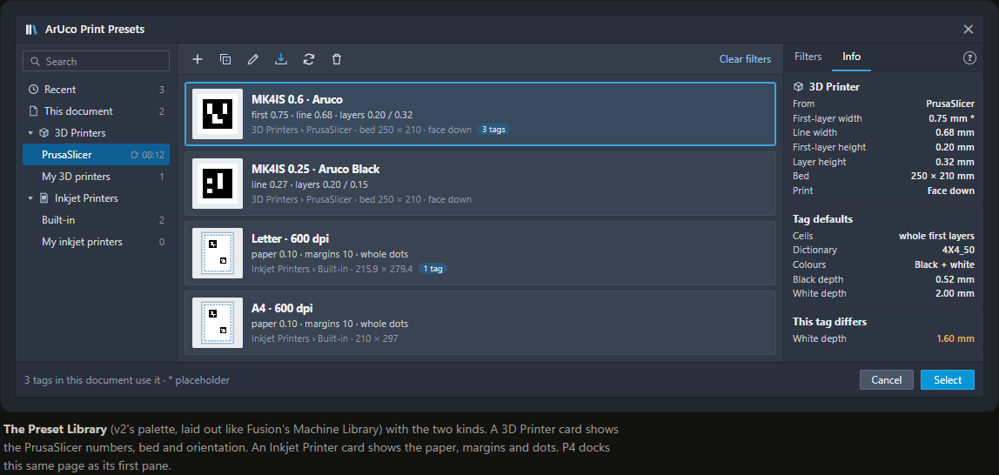
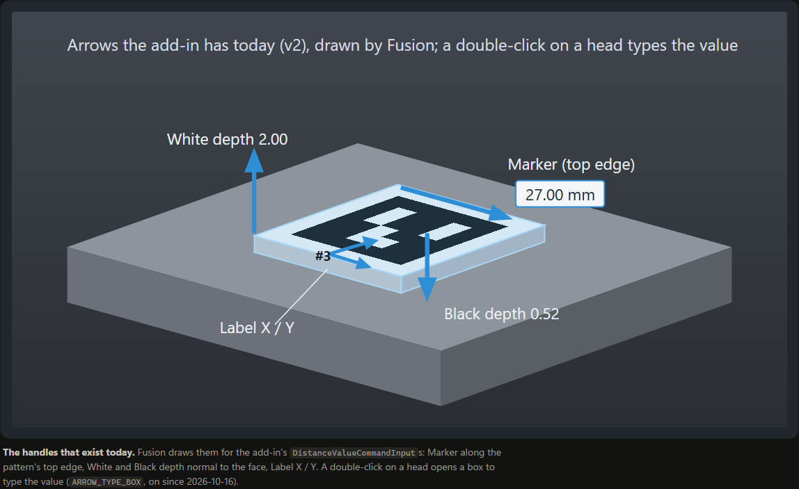
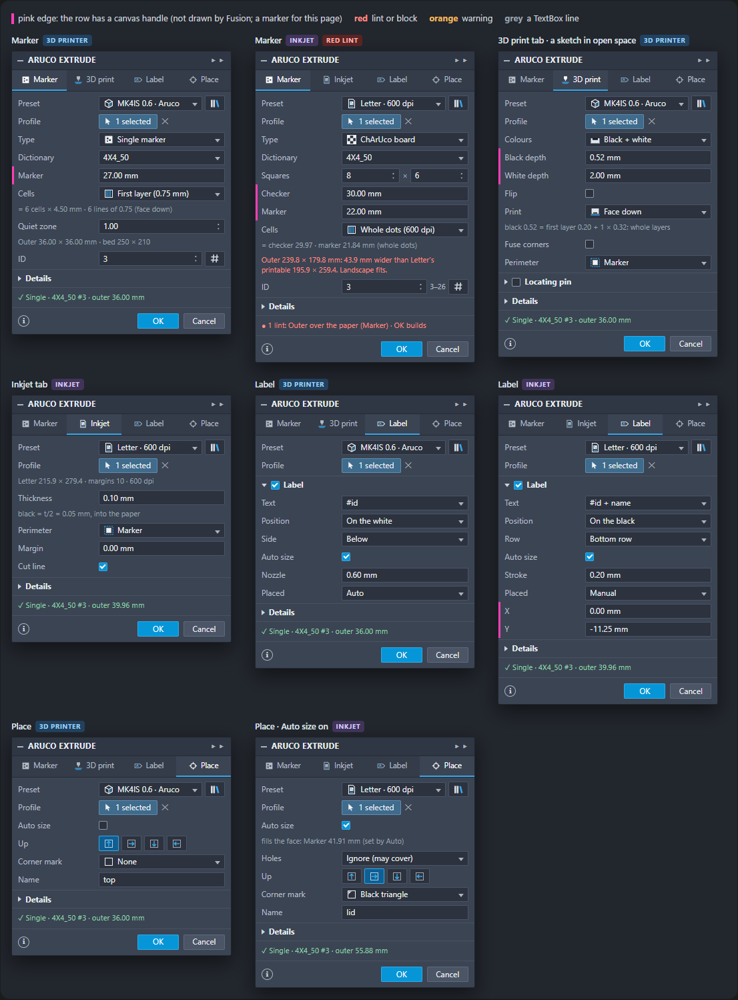
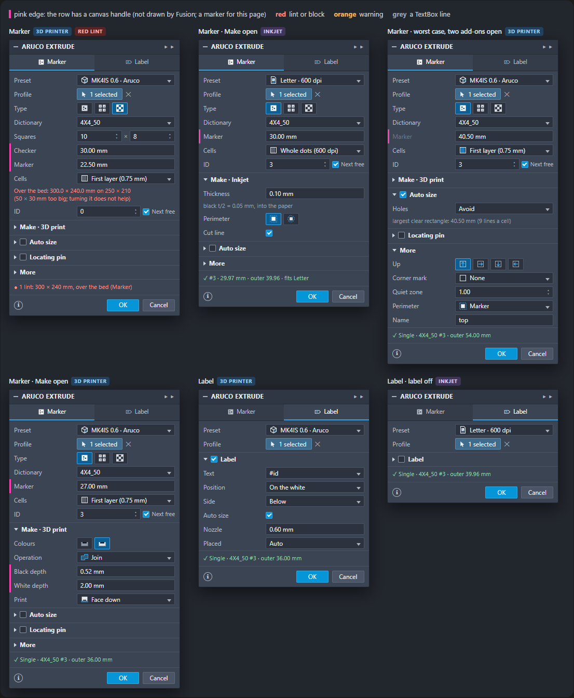
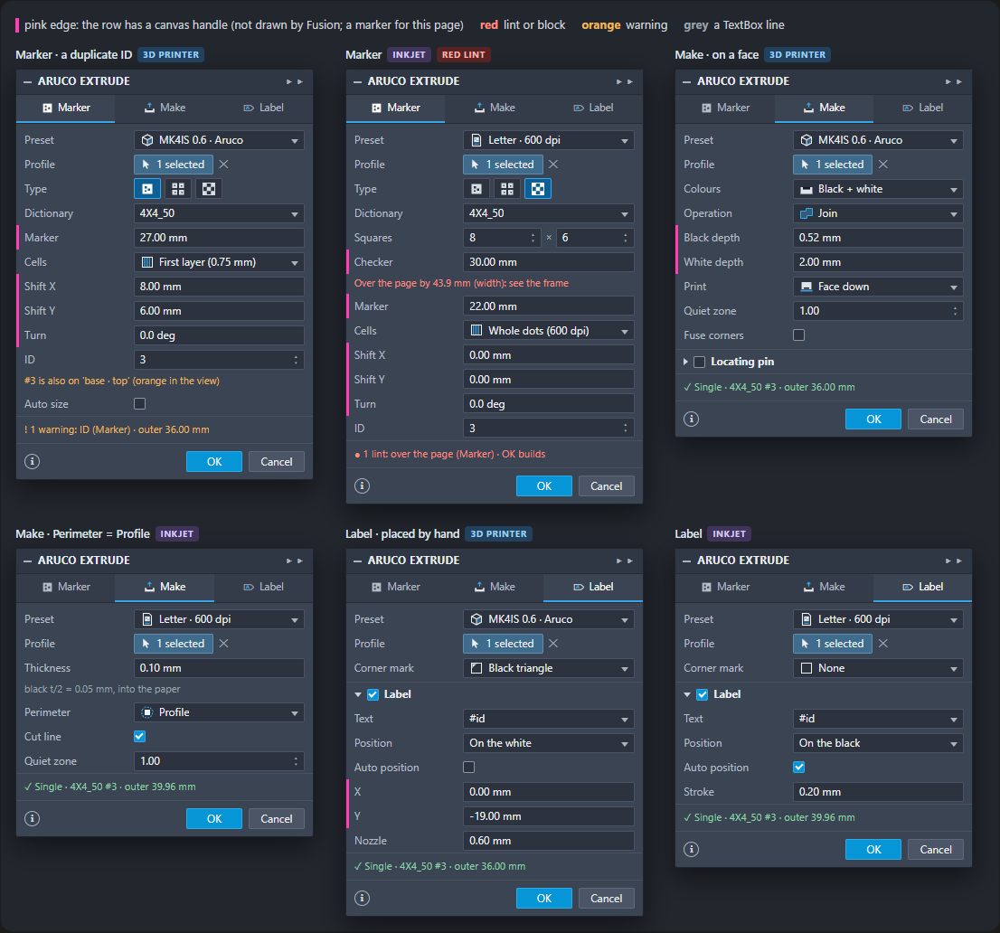
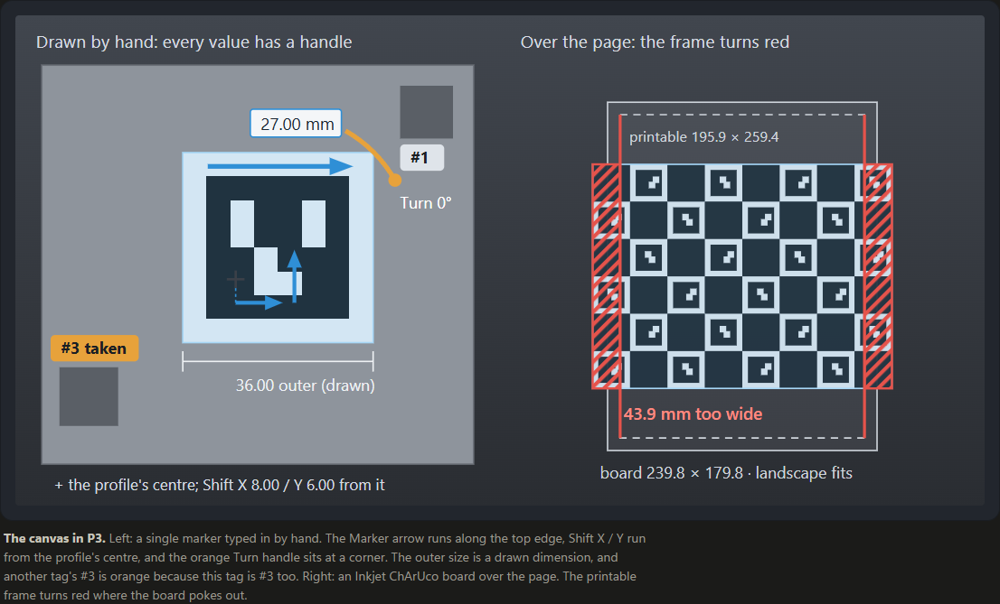
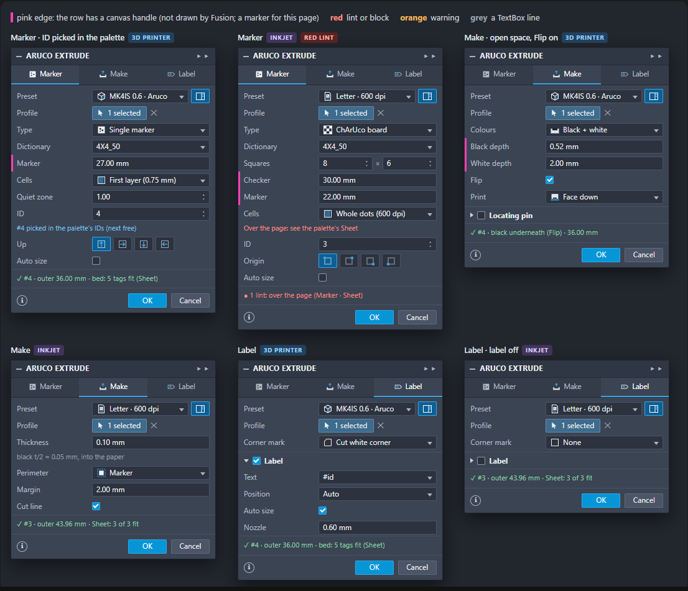
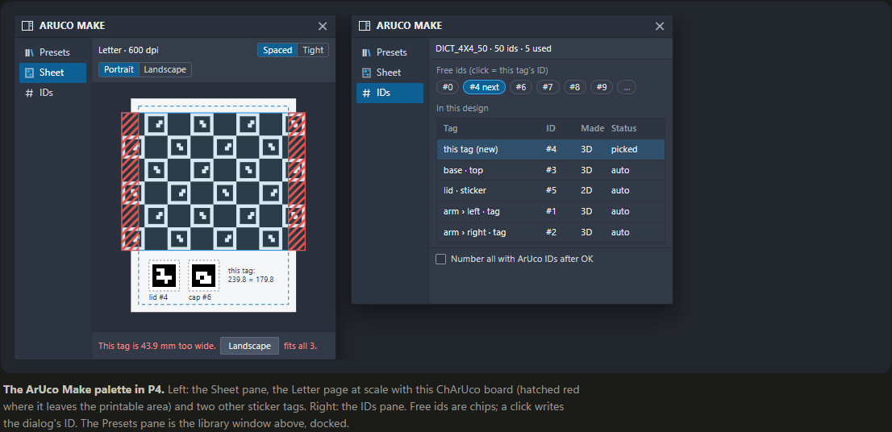
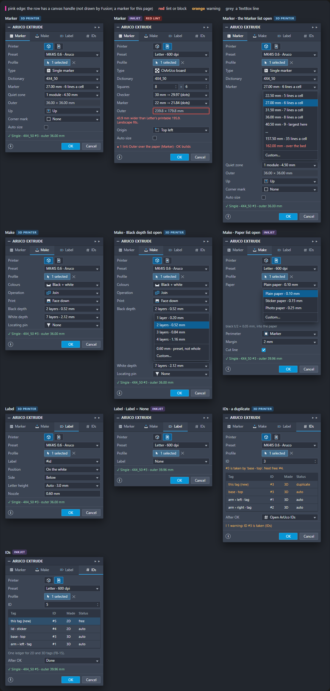
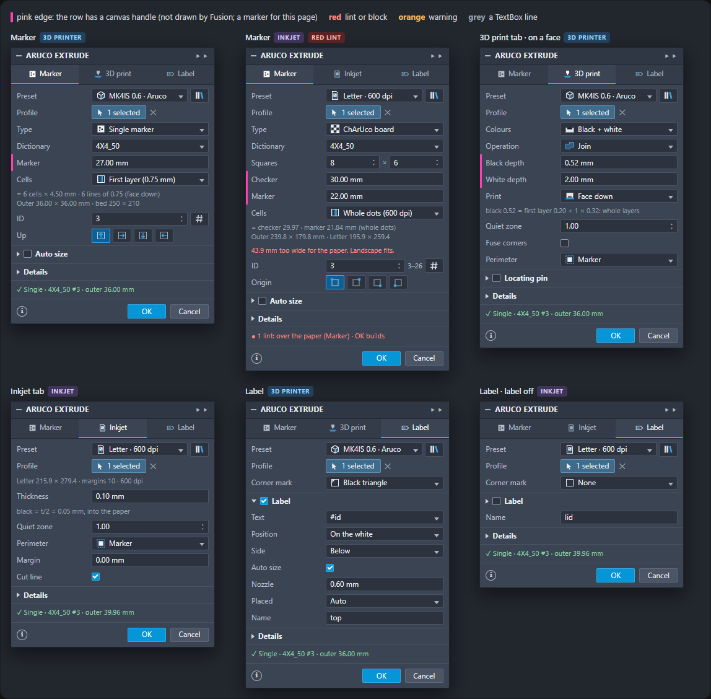

# ArUco Extrude: five dialog proposals (2026-10-17)

Five ways to lay out ArUco Extrude in Fusion around the core-first model of 2026-10-17. In all five, the Preset comes first and picks 3D Printer or Inkjet Printer. Marker is the first tab, and Label comes later. Each proposal is drawn tab by tab, for both kinds of preset, within the Fusion 2705 rules it must live with.

Zach's ask N-2. Design only: no add-in code changed, nothing run in Fusion. Written against aruco-studio `main` at `7a8a0cf` and the add-in worktree `aruco-fusion-plugin-0e9bcb` at `f5ebf4e`, where the v2 dialog is on (`UI_V2 = True`).

> “Please make 5 proposals for the UI/UX of the aruco extrude feature in fusion. ... Honestly sometimes constraints are good. so let me lean into that here. Presets is the first option, where you select the manufacturing method. I think the first tab as well can be for Marker. Then maybe you have another tab for Label.”
>
> Zach, 2026-10-17 (`docs/feedback/2026-10-17-markers-core-first.md`, N-2)

The page `index.html` shows the same content with Fusion-style mock-ups. The PNGs under `png/` are that page rendered headless. Below, each dialog is also drawn as text: `~` marks a row with a canvas handle, `[x v]` is a dropdown, `[x ^v]` a spinner, `[*a*]` the selected button of a ButtonRow, `<x>` a read-only field, `X` a red line, `!` an orange one, `.` a grey TextBox line.

## In short

- **P1 Four tabs.** v2 re-cut into Marker | Make | Label | Place. The Make tab is named after the method (*3D print* or *Inkjet*). The outer size is a grey line under the numbers. **M**.
- **P2 Core first.** Two tabs, Marker | Label. Everything optional is a folded group you tick, and the outer size sits in the summary line. **S–M**.
- **P3 On the model.** Arrows carry the numbers: size, checker, a new Shift, Turn and the depths. The page or bed is drawn around the tag, red where the tag pokes out. **M–L**.
- **P4 Make palette.** A palette beside the dialog holds the presets, the print sheet at true scale and the design's IDs. The dialog keeps only the tag's own rows. **L**.
- **P5 Pick from lists.** Thread-style: sizes come in whole cells, depths in whole layers and paper in real stocks, with Custom… as the way out. An IDs tab. **M**.
- **Pick:** P1's tabs cut down to three (Marker | Make | Label), with P2's tick-to-add groups. P3's page/bed frame comes later.

## What every proposal must express

|  | The dialog must… |
|---|---|
| CF-2 | Drawing a marker by hand works with nothing else on: Type, the numbers, an ID. Auto size, the label and pins are add-ons, off on a new tag. |
| CF-3 | The preset fills the make values. The dialog shows them and can change them for this tag. ArUco Export can override them again. Outside the tag, ArUco IDs changes only the ID. |
| CF-4 | Two kinds of preset. A **3D Printer** preset is synced from PrusaSlicer: first-layer width, line width, first-layer height, layer height, bed size and print orientation. An **Inkjet Printer** preset has the paper size, the paper thickness and the margins. Face down, the cells are whole first-layer widths. |
| CF-5 | Type, then the inner numbers (marker, checker, spacing, columns × rows), then the outer size. The outer size is derived and read only. |
| CF-6 | The max is the bed, or the paper minus its margins. A tag over it is flagged red, like a linter, and OK stays on. |
| CF-7 | Inkjet: the tag is a thin rectangle as thick as the paper (t). The black goes t/2 into it. |
| CF-8 | 3D: flush only. There is a Black depth, plus a White depth when white is printed. Flip shows only for black + white with no reference face. |
| CF-9 | The label comes after Make and is off by default. It is never in the way. |
| CF-10 | A clear door to ArUco IDs. |

### New in the model (all five need it; built after N-1)

- **Preset fields.** A 3D Printer preset gains `first_layer_width_mm`, `bed_mm` [w, h] and `orientation` (face_down / face_up). The Inkjet Printer is today's sticker preset under a new name: `page`, `landscape`, `margin_mm`, `stock_mm` (the paper thickness) and `dpi`.
- **Cells follow the orientation.** Face down, a cell is a whole number of first-layer widths. Face up, it is a whole number of line widths. Inkjet cells are whole dots.
- **Outer and max.** The plan gets a derived `outer_mm`, and the preset gives the max. A new Issue level, `lint`, is red but leaves OK on (the table below).
- **Make rule 2 for a sticker.** The black sits t/2 inside the paper. Rule 1 (ink on top) stays for the tags that have it.
- **Flip in the core.** A tag made in open space gets `flip` (the add-in already has a Flip input).
- **P3 only:** `settings.offset_mm` (Shift), versioned like `cells` and `trim`.

### The levels, with the new lint

| Level | Colour | OK | Examples |
|---|---|---|---|
| block | red | off | ids past the dictionary; nothing fits the profile |
| lint (new) | red | on | the outer size is over the bed or the printable paper (CF-6) |
| warn | orange | on | a cell under Min cell; a duplicate ID; a label built anyway |
| info | grey / blue | on | the rounding; what a preset changed |

The numbers in the mock-ups are illustrative. The 3D preset is Zach's “0.32mm SPEED @MK4IS 0.6 - Aruco” (0.68 mm lines, 0.20 / 0.32 mm layers), with a **placeholder first-layer width of 0.75 mm** and the MK4's 250 × 210 mm bed. The Inkjet preset is today's built-in “Sticker · Letter · 600 dpi” (0.10 mm paper, 10 mm margins).

## Shared by all five

| Fusion fact | What the proposals do |
|---|---|
| Nothing renders above the tab strip. | Root inputs show as the first rows of every tab. So Preset and Profile are root rows: the first thing on every tab, just under the strip. |
| A dropdown item's icon is given at `listItems.add`. | Lists with icons are rebuilt whole, all items with icons (v2's `ensure_icons`). The long number lists in P5 are text only. |
| A tab click fires inputChanged with the id `APITabBar`. | Each tab can show only its own arrows (`HANDLES_BY_TAB`). P3 relies on it. |
| In a Part design a custom feature has no Edit Feature. | Every proposal edits through today's right-click *Edit ArUco Extrude*. In Hybrid, a double-click on the node works. |
| A Palette can stay open beside the dialog and write to its inputs. | This was measured with v2's library. The write must happen inside refresh's before hook, or Fusion's echoes re-enter. |
| No row label and no tab can change its name or carry a badge. | Messages go on rows under the input, and one summary line names the tab. A group's name is fixed too, so P2 builds two Make groups. |
| Starting a command pre-empts the open one and runs it as OK by default. | So the hand-off to ArUco IDs means “OK, then IDs” (P1, P5). |

Also shared:

- **Root rows.** Preset is row 1 and Profile row 2. Both show at the top of every tab. A summary line shows at the bottom of every tab.
- **Per-line validation.** v2's `Validator` puts each message on a row under its input, plus one summary line. The new `lint` level is red with OK still on.
- **The library.** v2's palette (measured to work while the dialog is open) has two collections, 3D Printers (PrusaSlicer, synced) and Inkjet Printers. Its Info lists the CF-4 fields and what this tag changes.
- **Editing.** In a Part design, through the right-click *Edit ArUco Extrude* (Fusion gives a custom feature no Edit Feature there). In Hybrid, a double-click on the node.





## P1 · Four tabs, one per concern

Today's v2 dialog re-cut to the new model: Preset on top, then Marker | Make | Label | Place. The Make tab is named after the method.

### The idea

- **Preset row** (root): an icon DropDown plus the library button in one borderless Table, as in v2. Each item's icon tells 3D from Inkjet.
- **Marker** holds only what makes the pattern, in CF-5's order: Type, Dictionary, the inner numbers, Cells, Quiet zone, the outer size, ID.
- **Make** is built twice, as *3D print* (printer icon) and *Inkjet* (page icon). Only the preset's kind is visible, so the tab strip itself says how the tag is made. If Fusion won't hide a tab, the fallback is one *Make* tab whose rows swap.
- **Label**: the label in one check-box group.
- **Place**: where and which way. Auto size (off by default), Holes, Up, Corner mark and Name.
- **Outer size**: one grey line under the numbers, “Outer 36.00 × 36.00 mm · bed 250 × 210”. Over the max it turns red, says by how much and whether turning the page fixes it. The summary names the tab, and OK stays on.
- **ID**: a spinner, plus a **#** icon button that means “OK, then ArUco IDs on this tag”.

### Every tab, both kinds



```text
Marker · 3D Printer
+ ARUCO EXTRUDE ----------------------------------------+
| [Marker]| 3D print | Label | Place                    |
|-------------------------------------------------------|
| Preset         [MK4IS 0.6 · Aruco v] [lib]            |
| Profile        [> 1 selected x]                       |
| Type           [Single marker v]                      |
| Dictionary     [4X4_50 v]                             |
|~Marker         [27.00 mm]                             |
| Cells          [First layer (0.75 mm) v]              |
|  . = 6 cells × 4.50 mm · 6 lines of 0.75 (face down)  |
| Quiet zone     [1.00 ^v]                              |
|  . Outer 36.00 × 36.00 mm · bed 250 × 210             |
| ID             [3 ^v] [#]                             |
|> Details                                              |
|  ✓ Single · 4X4_50 #3 · outer 36.00 mm                |
|   (i)                     [ OK ] [Cancel]             |
+-------------------------------------------------------+
```

```text
Marker · Inkjet Printer · the red lint
+ ARUCO EXTRUDE ------------------------------------------+
| [Marker]| Inkjet | Label | Place                        |
|---------------------------------------------------------|
| Preset         [Letter · 600 dpi v] [lib]               |
| Profile        [> 1 selected x]                         |
| Type           [ChArUco board v]                        |
| Dictionary     [4X4_50 v]                               |
| Squares        [8 ^v] × [6 ^v]                          |
|~Checker        [30.00 mm]                               |
|~Marker         [22.00 mm]                               |
| Cells          [Whole dots (600 dpi) v]                 |
|  . = checker 29.97 · marker 21.84 mm (whole dots)       |
|  X Outer 239.8 × 179.8 mm: 43.9 mm wider than Letter's  |
|  X printable 195.9 × 259.4. Landscape fits.             |
| ID             [3 ^v] 3–26 [#]                          |
|> Details                                                |
|  ● 1 lint: Outer over the paper (Marker) · OK builds    |
|   (i)                     [ OK ] [Cancel]               |
+---------------------------------------------------------+
```

```text
3D print tab · 3D Printer · a sketch in open space
+ ARUCO EXTRUDE ---------------------------------------------+
|  Marker |[3D print]| Label | Place                         |
|------------------------------------------------------------|
| Preset         [MK4IS 0.6 · Aruco v] [lib]                 |
| Profile        [> 1 selected x]                            |
| Colours        [Black + white v]                           |
|~Black depth    [0.52 mm]                                   |
|~White depth    [2.00 mm]                                   |
| Flip           [ ]                                         |
| Print          [Face down v]                               |
|  . black 0.52 = first layer 0.20 + 1 × 0.32: whole layers  |
| Fuse corners   [ ]                                         |
| Perimeter      [Marker v]                                  |
|> [ ] Locating pin                                          |
|> Details                                                   |
|  ✓ Single · 4X4_50 #3 · outer 36.00 mm                     |
|   (i)                     [ OK ] [Cancel]                  |
+------------------------------------------------------------+
```

```text
Inkjet tab · Inkjet Printer
+ ARUCO EXTRUDE ----------------------------------+
|  Marker |[Inkjet]| Label | Place                |
|-------------------------------------------------|
| Preset         [Letter · 600 dpi v] [lib]       |
| Profile        [> 1 selected x]                 |
|  . Letter 215.9 × 279.4 · margins 10 · 600 dpi  |
| Thickness      [0.10 mm]                        |
|  . black = t/2 = 0.05 mm, into the paper        |
| Perimeter      [Marker v]                       |
| Margin         [0.00 mm]                        |
| Cut line       [x]                              |
|> Details                                        |
|  ✓ Single · 4X4_50 #3 · outer 39.96 mm          |
|   (i)                     [ OK ] [Cancel]       |
+-------------------------------------------------+
```

```text
Label · 3D Printer
+ ARUCO EXTRUDE -------------------------------+
|  Marker | 3D print |[Label]| Place           |
|----------------------------------------------|
| Preset         [MK4IS 0.6 · Aruco v] [lib]   |
| Profile        [> 1 selected x]              |
|v [x] Label                                   |
| Text           [#id v]                       |
| Position       [On the white v]              |
| Side           [Below v]                     |
| Auto size      [x]                           |
| Nozzle         [0.60 mm]                     |
| Placed         [Auto v]                      |
|> Details                                     |
|  ✓ Single · 4X4_50 #3 · outer 36.00 mm       |
|   (i)                     [ OK ] [Cancel]    |
+----------------------------------------------+
```

```text
Label · Inkjet Printer
+ ARUCO EXTRUDE -------------------------------+
|  Marker | Inkjet |[Label]| Place             |
|----------------------------------------------|
| Preset         [Letter · 600 dpi v] [lib]    |
| Profile        [> 1 selected x]              |
|v [x] Label                                   |
| Text           [#id + name v]                |
| Position       [On the black v]              |
| Row            [Bottom row v]                |
| Auto size      [x]                           |
| Stroke         [0.20 mm]                     |
| Placed         [Manual v]                    |
|~X              [0.00 mm]                     |
|~Y              [-11.25 mm]                   |
|> Details                                     |
|  ✓ Single · 4X4_50 #3 · outer 39.96 mm       |
|   (i)                     [ OK ] [Cancel]    |
+----------------------------------------------+
```

```text
Place · 3D Printer
+ ARUCO EXTRUDE -------------------------------+
|  Marker | 3D print | Label |[Place]          |
|----------------------------------------------|
| Preset         [MK4IS 0.6 · Aruco v] [lib]   |
| Profile        [> 1 selected x]              |
| Auto size      [ ]                           |
| Up             [*up*] [>] [v] [<]            |
| Corner mark    [None v]                      |
| Name           [top]                         |
|> Details                                     |
|  ✓ Single · 4X4_50 #3 · outer 36.00 mm       |
|   (i)                     [ OK ] [Cancel]    |
+----------------------------------------------+
```

```text
Place · Inkjet Printer · Auto size on
+ ARUCO EXTRUDE ------------------------------------+
|  Marker | Inkjet | Label |[Place]                 |
|---------------------------------------------------|
| Preset         [Letter · 600 dpi v] [lib]         |
| Profile        [> 1 selected x]                   |
| Auto size      [x]                                |
|  . fills the face: Marker 41.91 mm (set by Auto)  |
| Holes          [Ignore (may cover) v]             |
| Up             [up] [*>*] [v] [<]                 |
| Corner mark    [Black triangle v]                 |
| Name           [lid]                              |
|> Details                                          |
|  ✓ Single · 4X4_50 #3 · outer 55.88 mm            |
|   (i)                     [ OK ] [Cancel]         |
+---------------------------------------------------+
```

### Rows

| Tab | id | Label | CommandInput | Shown when | Default | Source in `plan/fields.py` (or new) |
|---|---|---|---|---|---|---|
| root | `preset` | Preset | DropDown, LabeledIconDropDownStyle (item icon = kind, given at `listItems.add`), in a borderless Table with the library button | always (root, row 1) | last used, else Default (3D) | outside row `preset` (ROWS_OUTSIDE); it sets `settings.make.by` (read only) |
| root | `library` | (library) | BoolValue button, icon `library`, in the Preset row's Table | always | – | v2 `library_btn` |
| root | `target` | Profile | Selection (PlanarFaces, Profiles; 1..n faces, FB-14) | a new tag (an edit has none) | – | outside row `target` (`target.*`) |
| Marker | `layout` | Type | DropDown, icons | always | Single marker | `settings.layout` |
| Marker | `dictionary` | Dictionary | DropDown | always | preset (4X4_50) | `settings.dictionary` |
| Marker | `force` | Squares / Markers | Table: 2 × IntegerSpinner | grid, ChArUco | 5 × 7 (ChArUco), 2 × 2 (grid) | `settings.force` |
| Marker | `square` | Checker | ValueInput + DistanceValue manipulator | ChArUco | 20.00 mm | `numbers.square` |
| Marker | `size` | Marker | DistanceValue + manipulator (top edge) | always | typed 27.00 mm, rounded by Cells (Auto: set by the fit) | `numbers.size` |
| Marker | `gap` | Spacing | ValueInput | grid | derived: max(0.2 L, L / n), whole cells | new (today derived, no field) |
| Marker | `cells` | Cells | DropDown, icons: First-layer width / Line width / Whole dots / 0.5 mm steps / Custom… | always | preset (face down: first-layer width) | `settings.cells` |
| Marker | `cell_mm` | Cell width | ValueInput | Cells = Custom… | the preset's line | `settings.cells` (mm) |
| Marker | `size_round` | (rounding) | TextBox, grey, 1 row | a tag is evaluated | – | v2 `size_round` |
| Marker | `quiet` | Quiet zone | FloatSpinner (modules) | always | preset (1.00) | `settings.quiet_modules` |
| Marker | `outer` | (outer) | TextBox, grey, 1–2 rows; red over the max (new level: lint) | always | derived | new: the plan's outer box vs the preset's max |
| Marker | `marker_id` | ID | IntegerSpinner | always | the design's next free id | `numbers.marker_id` |
| Marker | `ids_btn` | (# ArUco IDs) | BoolValue button, icon `ids`, in the ID row's Table | always | – | new: OK, then ArUco IDs on this tag |
| 3D print | `mode` | Colours | DropDown, icons: Black + white / Black only | 3D | preset | `settings.mode` (CF-8: Auto and White only leave the new-tag list) |
| 3D print | `op` | Operation | DropDown, icons: Join / New body | 3D, Black + white, on a body | Join | `settings.op` |
| 3D print | `black` | Black depth | DistanceValue + manipulator | 3D | preset (0.52 mm) | `numbers.black_height` (`black_offset` fixed: flush, CF-8) |
| 3D print | `white` | White depth | DistanceValue + manipulator | 3D, Black + white | preset (2.00 mm) | `numbers.white_height` (`white_offset` fixed: 0) |
| 3D print | `flip` | Flip | BoolValue | 3D, Black + white, no reference face (open space) | off | new in the core (the add-in has `flip`); CF-8 |
| 3D print | `orient` | Print | DropDown, icons: Face down / Face up | 3D | preset | new `settings.make.orientation` (preset `orientation`, CF-4) |
| 3D print | `layers` | (layers) | TextBox, grey | 3D, the preset knows its layers | – | add-in `layers_note` (`aruco_presets.layer_note`) |
| 3D print | `grow` | Fuse corners | BoolValue | 3D | preset (off) | `settings.grow` |
| 3D print | `perimeter` | Perimeter (Trim excess) | DropDown, icons: Marker / Profile | always | Marker | `settings.make.perimeter` (Inkjet) = `settings.trim` (3D) |
| 3D print | `pin` | Locating pin | Group, check-box header: Shape, Size, Length (manipulator), Tolerance | 3D | preset | `settings.pin`, `numbers.pin_*` |
| Inkjet | `paper` | (paper) | TextBox, grey | Inkjet | preset | preset `page`, `landscape`, `margin_mm`, `dpi` (read only here) |
| Inkjet | `thickness` | Thickness | ValueInput | Inkjet | preset (0.10 mm) | `settings.make.thickness_mm` |
| Inkjet | `black2d` | (black t/2) | TextBox, grey | Inkjet | – | new: make rule 2 (CF-7) |
| Inkjet | `perimeter` | Perimeter | DropDown, icons: Marker / Profile | always | Marker | `settings.make.perimeter` (Inkjet) = `settings.trim` (3D) |
| Inkjet | `margin` | Margin | ValueInput | Inkjet, Perimeter = Marker | 0.00 mm | `settings.make.margin_mm` |
| Inkjet | `cut_line` | Cut line | BoolValue | Inkjet | on | `settings.make.cut_line` |
| Label | `label_on` | Label | Group, check-box header | always | preset (off) | `settings.label.on` |
| Label | `label_content` | Text | DropDown | label on | #id | `settings.label.content` |
| Label | `label_text` | Custom text | StringValue | Text = Custom | '' | `settings.label.text` |
| Label | `label_place` | Position | DropDown: Auto / On the black / On the white (ChArUco: In a black square) | label on | Auto | `settings.label.place` |
| Label | `label_row` | Row / Side | DropDown | on the black / on the white; not ChArUco | Auto | `settings.label.row`, `settings.label.side` |
| Label | `label_cap` | Auto size / Letter height | BoolValue + ValueInput | label on | Auto | `settings.label.cap_mm` (0 = auto) |
| Label | `label_nozzle` | Nozzle / Stroke | ValueInput | label on | preset (0.60 / 0.20 mm) | `settings.label.nozzle_mm` (`label_2d` Stroke) |
| Label | `label_pos` | Placed | DropDown: Auto / Manual | label on | Auto | `settings.label.position` |
| Label | `label_xy` | X, Y | 2 × ValueInput + DistanceValue manipulators | Placed = Manual | 0, 0 | `settings.label.x_mm`, `y_mm` |
| Label | `label_force` | Build anyway | BoolValue | while the label is refused | off | `settings.label.build_anyway` |
| Place | `auto` | Auto size | BoolValue | always | off (CF-2) | `numbers.size` = 0 |
| Place | `holes` | Holes | DropDown: Avoid / Ignore | Auto size on, the face has holes | Avoid (3D), Ignore (Inkjet) | `settings.holes` |
| Place | `turn` | Up / Origin | ButtonRow, 4 icons (single: up-t/r/b/l; board: the corners) | always | 0 | `settings.turn` |
| Place | `corner_mark` | Corner mark | DropDown, icons | always | preset (None) | `settings.corner_mark` |
| Place | `name` | Name | StringValue | always | '' | `name` |
| root | `details` | Details | Group (folded) + TextBox | always (root, after the tabs' rows) | folded | v2 `details` (today's info box) |
| root | `summary` | (summary) | TextBox, 1 row | always (root, last row) | – | kit `Validator` summary, plus the outer size |

### How it meets CF-2 … CF-10

|  | How |
|---|---|
| CF-2 | Auto size lives on Place and is off on a new tag. The Marker tab is typing numbers. |
| CF-3 | The preset fills Make and Cells. A changed value makes the Preset row read *(modified)*, and v2's blue note says what differs. ArUco Export can override again. |
| CF-4 | The two kinds are two Make tabs. The Preset list's icons show the kind. |
| CF-5 | Type, then the numbers, then the read-only outer line. |
| CF-6 | A red line under Outer, plus the summary. OK stays on. |
| CF-7 | The Inkjet tab has Thickness and a grey “black t/2 into the paper” line. It has no depth rows. |
| CF-8 | The 3D print tab has Colours (Black + white / Black only), Black depth and White depth. Flip shows only in open space with black + white. |
| CF-9 | Label is the third tab, behind a check box. |
| CF-10 | The ID row's **#** button. |

### Against the UI bar

| Rule |  | Notes |
|---|---|---|
| Compact, Fusion-native | ✓ | Setup-like icon tabs; 4–9 rows a tab plus 3 root rows. |
| Tabs ≤ ~10 rows, icons, groups | ✓ | The largest tab is 3D print, with 9 rows. |
| Options where they act | ✓ | Cells and the rounding line sit right under Marker. |
| No full-width button rows | ✓ | # and the library are icon buttons in Table rows. |
| Collections in a library palette | ✓ | v2's palette, with 3D Printers and Inkjet Printers collections. |
| Handles for natural drags | ✓ | Marker, Checker, both depths, pin length, label X / Y. |
| A row per warning + one summary | ✓ | v2's Validator, plus the lint level. |
| Reuse the kit | ✓ | Layout routing, Validator, Arrows, ensure_icons, the library. |

### Canvas handles

- **Marker**: a dimension arrow along the pattern's top edge (exists in v2); the ghost snaps to whole cells
- **Checker**: new: the same arrow along one square's top edge
- **Black depth / White depth**: arrows normal to the face (exist)
- **Pin length**: exists
- **Label X / Y**: two arrows (exist), shown when Placed = Manual

### Pros

- The smallest step from v2: a new routing table plus the Inkjet rows. Every handler stays.
- Each concern has a home, so a row is easy to find.
- The tab strip names the method at a glance.

### Cons

- Four tabs for about 25 rows of real choices.
- Place splits “where” from “what”: Up is really about the marker.
- Hiding a tab is untested.
- The # hand-off ends the dialog. It is OK, then IDs: you can't come back to the dialog.

### Effort and risks

**M**: 3–4 days: the routing table, the Inkjet rows, the outer line and lint level, the # hand-off, the hidden-tab probe.

- `TabCommandInput.isVisible` on a tab: check. Fallback: one Make tab.
- The # button starts ArUco IDs. Fusion's pre-emption (`isExecutedWhenPreEmpted`, true by default) runs this dialog's OK first. Check that the transaction completes before IDs opens, and that IDs can be told which tag to select (a module global).
- Preset items with icons: the list must be rebuilt whole whenever the library changes (“bad allocation” otherwise).

## P2 · Core first: two tabs, add-ons you tick

Marker | Label only. The Marker tab is the whole core, and everything optional is a folded group with a check box in its header.

### The idea

- **Marker tab, top to bottom:** Type as an icon **ButtonRow**, Dictionary, the inner numbers, Cells, and ID with a *Next free* check box. Then one **Make** group, folded, because the preset already holds good values. Then the add-ons, each a group with a check box in its header, folded while off: *Auto size* (Holes inside), *Locating pin* (3D) and *More* (Up, Corner mark, Quiet zone, Perimeter, Name).
- **Label tab:** one check-box group.
- **The outer size lives in the summary line**, which every tab shows: “✓ #3 · 29.97 mm · outer 39.96 · fits Letter”. Over the max, a red row appears under the number that set it, and the summary turns red.
- **Make group, one per kind:** a group's name cannot change, so there are two, *Make · 3D print* and *Make · Inkjet*, and only one is visible.
- **The accordion rule:** opening one add-on group folds the others (`isExpanded` set by code), so the tab never needs to scroll.

### Every tab, both kinds



```text
Marker · 3D Printer · the red lint
+ ARUCO EXTRUDE -------------------------------------+
| [Marker]| Label                                    |
|----------------------------------------------------|
| Preset         [MK4IS 0.6 · Aruco v]               |
| Profile        [> 1 selected x]                    |
| Type           [single] [grid] [*ChArUco*]         |
| Dictionary     [4X4_50 v]                          |
| Squares        [10 ^v] × [8 ^v]                    |
|~Checker        [30.00 mm]                          |
|~Marker         [22.50 mm]                          |
| Cells          [First layer (0.75 mm) v]           |
|  X Over the bed: 300.0 × 240.0 mm on 250 × 210     |
|  X (50 × 30 mm too big; turning it does not help)  |
| ID             [0 ^v] [x] Next free                |
|> Make · 3D print                                   |
|> [ ] Auto size                                     |
|> [ ] Locating pin                                  |
|> More                                              |
|  ● 1 lint: 300 × 240 mm, over the bed (Marker)     |
|   (i)                     [ OK ] [Cancel]          |
+----------------------------------------------------+
```

```text
Marker · Inkjet Printer · Make open
+ ARUCO EXTRUDE --------------------------------+
| [Marker]| Label                               |
|-----------------------------------------------|
| Preset         [Letter · 600 dpi v]           |
| Profile        [> 1 selected x]               |
| Type           [*single*] [grid] [ChArUco]    |
| Dictionary     [4X4_50 v]                     |
|~Marker         [30.00 mm]                     |
| Cells          [Whole dots (600 dpi) v]       |
| ID             [3 ^v] [x] Next free           |
|v Make · Inkjet                                |
| Thickness      [0.10 mm]                      |
|  . black t/2 = 0.05 mm, into the paper        |
| Perimeter      [*marker*] [profile]           |
| Cut line       [x]                            |
|> [ ] Auto size                                |
|> More                                         |
|  ✓ #3 · 29.97 mm · outer 39.96 · fits Letter  |
|   (i)                     [ OK ] [Cancel]     |
+-----------------------------------------------+
```

```text
Marker · 3D Printer · worst case, two add-ons open
+ ARUCO EXTRUDE -----------------------------------------+
| [Marker]| Label                                        |
|--------------------------------------------------------|
| Preset         [MK4IS 0.6 · Aruco v]                   |
| Profile        [> 1 selected x]                        |
| Type           [*single*] [grid] [ChArUco]             |
| Dictionary     [4X4_50 v]                              |
|~Marker         [40.50 mm]                              |
| Cells          [First layer (0.75 mm) v]               |
| ID             [3 ^v] [x] Next free                    |
|> Make · 3D print                                       |
|v [x] Auto size                                         |
| Holes          [Avoid v]                               |
|  . largest clear rectangle: 40.50 mm (9 lines a cell)  |
|> [ ] Locating pin                                      |
|v More                                                  |
| Up             [*up*] [>] [v] [<]                      |
| Corner mark    [None v]                                |
| Quiet zone     [1.00 ^v]                               |
| Perimeter      [Marker v]                              |
| Name           [top]                                   |
|  ✓ Single · 4X4_50 #3 · outer 54.00 mm                 |
|   (i)                     [ OK ] [Cancel]              |
+--------------------------------------------------------+
```

```text
Marker · 3D Printer · Make open
+ ARUCO EXTRUDE -------------------------------+
| [Marker]| Label                              |
|----------------------------------------------|
| Preset         [MK4IS 0.6 · Aruco v]         |
| Profile        [> 1 selected x]              |
| Type           [*single*] [grid] [ChArUco]   |
| Dictionary     [4X4_50 v]                    |
|~Marker         [27.00 mm]                    |
| Cells          [First layer (0.75 mm) v]     |
| ID             [3 ^v] [x] Next free          |
|v Make · 3D print                             |
| Colours        [black] [*b+w*]               |
| Operation      [Join v]                      |
|~Black depth    [0.52 mm]                     |
|~White depth    [2.00 mm]                     |
| Print          [Face down v]                 |
|> [ ] Auto size                               |
|> [ ] Locating pin                            |
|> More                                        |
|  ✓ Single · 4X4_50 #3 · outer 36.00 mm       |
|   (i)                     [ OK ] [Cancel]    |
+----------------------------------------------+
```

```text
Label · 3D Printer
+ ARUCO EXTRUDE -------------------------------+
|  Marker |[Label]                             |
|----------------------------------------------|
| Preset         [MK4IS 0.6 · Aruco v]         |
| Profile        [> 1 selected x]              |
|v [x] Label                                   |
| Text           [#id v]                       |
| Position       [On the white v]              |
| Side           [Below v]                     |
| Auto size      [x]                           |
| Nozzle         [0.60 mm]                     |
| Placed         [Auto v]                      |
|  ✓ Single · 4X4_50 #3 · outer 36.00 mm       |
|   (i)                     [ OK ] [Cancel]    |
+----------------------------------------------+
```

```text
Label · Inkjet Printer · label off
+ ARUCO EXTRUDE -------------------------------+
|  Marker |[Label]                             |
|----------------------------------------------|
| Preset         [Letter · 600 dpi v]          |
| Profile        [> 1 selected x]              |
|> [ ] Label                                   |
|  ✓ Single · 4X4_50 #3 · outer 39.96 mm       |
|   (i)                     [ OK ] [Cancel]    |
+----------------------------------------------+
```

### Rows

| Tab | id | Label | CommandInput | Shown when | Default | Source in `plan/fields.py` (or new) |
|---|---|---|---|---|---|---|
| root | `preset` | Preset | DropDown, icons (kind); a separator between the kinds; last item *Library…* opens the palette | always (root, row 1) | last used, else Default (3D) | outside row `preset` (ROWS_OUTSIDE); it sets `settings.make.by` (read only) |
| root | `target` | Profile | Selection (PlanarFaces, Profiles; 1..n faces, FB-14) | a new tag (an edit has none) | – | outside row `target` (`target.*`) |
| Marker | `layout` | Type | ButtonRow, 3 icons (single / grid / ChArUco) | always | Single marker | `settings.layout` |
| Marker | `dictionary` | Dictionary | DropDown | always | preset (4X4_50) | `settings.dictionary` |
| Marker | `force` | Squares / Markers | Table: 2 × IntegerSpinner | grid, ChArUco | 5 × 7 (ChArUco), 2 × 2 (grid) | `settings.force` |
| Marker | `square` | Checker | ValueInput + DistanceValue manipulator | ChArUco | 20.00 mm | `numbers.square` |
| Marker | `size` | Marker | DistanceValue + manipulator (top edge) | always | typed 27.00 mm, rounded by Cells (Auto: set by the fit) | `numbers.size` |
| Marker | `gap` | Spacing | ValueInput | grid | derived: max(0.2 L, L / n), whole cells | new (today derived, no field) |
| Marker | `cells` | Cells | DropDown, icons: First-layer width / Line width / Whole dots / 0.5 mm steps / Custom… | always | preset (face down: first-layer width) | `settings.cells` |
| Marker | `cell_mm` | Cell width | ValueInput | Cells = Custom… | the preset's line | `settings.cells` (mm) |
| Marker | `marker_id` | ID | IntegerSpinner + BoolValue *Next free* in one Table row | always | Next free on: the design's next free id at OK | `numbers.marker_id` |
| Marker | `make_grp` | Make · 3D print / Make · Inkjet | Group × 2, only the preset's kind visible (a group's name cannot change) | always | folded (the preset's values) | new (layout only) |
| Marker › Make | `mode` | Colours | ButtonRow, 2 icons: Black only / Black + white | 3D | preset | `settings.mode` (CF-8: Auto and White only leave the new-tag list) |
| Marker › Make | `op` | Operation | DropDown, icons: Join / New body | 3D, Black + white, on a body | Join | `settings.op` |
| Marker › Make | `black` | Black depth | DistanceValue + manipulator | 3D | preset (0.52 mm) | `numbers.black_height` (`black_offset` fixed: flush, CF-8) |
| Marker › Make | `white` | White depth | DistanceValue + manipulator | 3D, Black + white | preset (2.00 mm) | `numbers.white_height` (`white_offset` fixed: 0) |
| Marker › Make | `flip` | Flip | BoolValue | 3D, Black + white, no reference face (open space) | off | new in the core (the add-in has `flip`); CF-8 |
| Marker › Make | `orient` | Print | DropDown, icons: Face down / Face up | 3D | preset | new `settings.make.orientation` (preset `orientation`, CF-4) |
| Marker › Make | `thickness` | Thickness | ValueInput | Inkjet | preset (0.10 mm) | `settings.make.thickness_mm` |
| Marker › Make | `black2d` | (black t/2) | TextBox, grey | Inkjet | – | new: make rule 2 (CF-7) |
| Marker › Make | `perimeter` | Perimeter | ButtonRow, 2 icons: Marker / Profile | Inkjet | Marker | `settings.make.perimeter` (Inkjet) = `settings.trim` (3D) |
| Marker › Make | `margin` | Margin | ValueInput | Inkjet, Perimeter = Marker | 0.00 mm | `settings.make.margin_mm` |
| Marker › Make | `cut_line` | Cut line | BoolValue | Inkjet | on | `settings.make.cut_line` |
| Marker | `auto_grp` | Auto size | Group, check-box header (ticked = Auto) | always | off (CF-2) | `numbers.size` = 0 |
| Marker › Auto size | `holes` | Holes | DropDown: Avoid / Ignore | the face has holes | Avoid (3D), Ignore (Inkjet) | `settings.holes` |
| Marker | `pin` | Locating pin | Group, check-box header: Shape, Size, Length (manipulator), Tolerance | 3D | preset | `settings.pin`, `numbers.pin_*` |
| Marker | `more_grp` | More | Group (folded) | always | folded | new (layout only) |
| Marker › More | `turn` | Up / Origin | ButtonRow, 4 icons (single: up-t/r/b/l; board: the corners) | always | 0 | `settings.turn` |
| Marker › More | `corner_mark` | Corner mark | DropDown, icons | always | preset (None) | `settings.corner_mark` |
| Marker › More | `quiet` | Quiet zone | FloatSpinner (modules) | always | preset (1.00) | `settings.quiet_modules` |
| Marker › More | `perimeter` | Perimeter | DropDown, icons: Marker / Profile | 3D (Trim excess) | Marker | `settings.make.perimeter` (Inkjet) = `settings.trim` (3D) |
| Marker › More | `grow` | Fuse corners | BoolValue | 3D | preset (off) | `settings.grow` |
| Marker › More | `name` | Name | StringValue | always | '' | `name` |
| Label | `label_on` | Label | Group, check-box header | always | preset (off) | `settings.label.on` |
| Label | `label_content` | Text | DropDown | label on | #id | `settings.label.content` |
| Label | `label_text` | Custom text | StringValue | Text = Custom | '' | `settings.label.text` |
| Label | `label_place` | Position | DropDown: Auto / On the black / On the white (ChArUco: In a black square) | label on | Auto | `settings.label.place` |
| Label | `label_row` | Row / Side | DropDown | on the black / on the white; not ChArUco | Auto | `settings.label.row`, `settings.label.side` |
| Label | `label_cap` | Auto size / Letter height | BoolValue + ValueInput | label on | Auto | `settings.label.cap_mm` (0 = auto) |
| Label | `label_nozzle` | Nozzle / Stroke | ValueInput | label on | preset (0.60 / 0.20 mm) | `settings.label.nozzle_mm` (`label_2d` Stroke) |
| Label | `label_pos` | Placed | DropDown: Auto / Manual | label on | Auto | `settings.label.position` |
| Label | `label_xy` | X, Y | 2 × ValueInput + DistanceValue manipulators | Placed = Manual | 0, 0 | `settings.label.x_mm`, `y_mm` |
| Label | `label_force` | Build anyway | BoolValue | while the label is refused | off | `settings.label.build_anyway` |
| root | `summary` | (summary) | TextBox, 1 row: the outer size lives here (CF-5) | always (root, last row) | – | kit `Validator` summary; new: outer + max |

### How it meets CF-2 … CF-10

|  | How |
|---|---|
| CF-2 | The core is 5–6 rows. Auto size, pins, label and the rest are literally opt-in. |
| CF-3 | Make is folded on the preset's values. Open it to change them for this tag, and the Preset row reads *(modified)*. |
| CF-4 | Two Make groups, one per kind, plus the list icons. |
| CF-5 | Type, then the numbers. The outer size in the summary is read only. |
| CF-6 | A red row under the number, plus the red summary. OK stays on. |
| CF-7 | *Make · Inkjet* has Thickness and the t/2 line. |
| CF-8 | *Make · 3D print* has Colours as a 2-icon ButtonRow and both depths. Flip shows in open space. |
| CF-9 | The whole Label tab is one tick. |
| CF-10 | *Next free* gives every new tag a free id. ArUco IDs stays a separate command. |

### Against the UI bar

| Rule |  | Notes |
|---|---|---|
| Compact, Fusion-native | ✓ | Two tabs; folded groups like CAM's check-box groups. |
| Tabs ≤ ~10 rows, icons, groups | ~ | A single marker shows 9 rows plus root rows. A board shows 12, and up to 18 with two groups open (the accordion rule caps it). |
| Options where they act | ✓ | Cells under Marker; Holes inside Auto size. |
| No full-width button rows | ✓ | ButtonRows are icon rows of 2–3. |
| Collections in a library palette | ✓ | *Library…* as the Preset list's last item opens it. |
| Handles for natural drags | ~ | Marker, Checker and depths. A folded group hides its arrows. |
| A row per warning + one summary | ✓ | The summary carries the outer size too. |
| Reuse the kit | ✓ | Group headers (measured), ButtonRow, Validator. |

### Canvas handles

- **Marker, Checker**: dimension arrows along a top edge
- **Black depth / White depth**: shown only while *Make* is open
- **Label X / Y**: Placed = Manual

### Pros

- The core marker is 5–6 rows. It is the clearest reading of “markers standalone, the rest on top”.
- Two tabs mean the fewest clicks.
- The outer size is always in view, on every tab.
- It is the cheapest to build: the group header check box already works (Locating pin, 2026-10-16).

### Cons

- One long tab when groups open. Needs the accordion rule.
- *More* becomes a junk drawer.
- A folded Make hides the depths, which matter for every 3D tag.
- The summary line is crowded: outer size, issues and ID.
- Two Make groups, because a group can't be renamed.

### Effort and risks

**S–M**: 2–3 days: the routing, two Make groups, the accordion rule, the summary words.

- Arrows of inputs inside a folded group: does Fusion still draw them? Check. Rule: an arrow shows only while its group is open.
- The accordion: setting `isExpanded` from inputChanged may echo events. Do it in after_refresh.
- Next free needs the design's ledger at dialog open (the IDs node, or a scan of the tags' attributes). Measure the time on the rack.

## P3 · On the model

The canvas carries the numbers. Arrows set the size, checker, shift and depths, and a turn handle sets Up. The page or bed is drawn around the tag, and the dialog stays at about 6 rows a tab.

### The idea

- **Every value set by hand has a handle** (CF-2, “draw markers”): Marker size, Checker, **Shift X / Y** (new: move the tag off the profile's centre), **Turn** (an AngleValue snapped to 90°), Black depth, White depth, Label X / Y.
- **The canvas shows what is derived.** The outer size is a dimension. The cell grid shows while you drag. The printable area (page minus margins, or the bed) is a dashed frame around the tag, red where the tag pokes out. Other tags' IDs show as small labels, orange when one is taken.
- **Three tabs**, Marker | Make | Label. Each tab shows only its own arrows (`APITabBar` → `HANDLES_BY_TAB`).
- **Preset**: a plain icon DropDown; *Library…* is its last item.
- **Type**: a ButtonRow.
- **The frame** shows only when the tag is within 20 % of the max or over it. A bed is far bigger than most tags, and a full frame would fill the view.

### Every tab, both kinds



```text
Marker · 3D Printer · a duplicate ID
+ ARUCO EXTRUDE --------------------------------------+
| [Marker]| Make | Label                              |
|-----------------------------------------------------|
| Preset         [MK4IS 0.6 · Aruco v]                |
| Profile        [> 1 selected x]                     |
| Type           [*single*] [grid] [ChArUco]          |
| Dictionary     [4X4_50 v]                           |
|~Marker         [27.00 mm]                           |
| Cells          [First layer (0.75 mm) v]            |
|~Shift X        [8.00 mm]                            |
|~Shift Y        [6.00 mm]                            |
|~Turn           [0.0 deg]                            |
| ID             [3 ^v]                               |
|  ! #3 is also on 'base · top' (orange in the view)  |
| Auto size      [ ]                                  |
|  ! 1 warning: ID (Marker) · outer 36.00 mm          |
|   (i)                     [ OK ] [Cancel]           |
+-----------------------------------------------------+
```

```text
Marker · Inkjet Printer · the red lint
+ ARUCO EXTRUDE --------------------------------------+
| [Marker]| Make | Label                              |
|-----------------------------------------------------|
| Preset         [Letter · 600 dpi v]                 |
| Profile        [> 1 selected x]                     |
| Type           [single] [grid] [*ChArUco*]          |
| Dictionary     [4X4_50 v]                           |
| Squares        [8 ^v] × [6 ^v]                      |
|~Checker        [30.00 mm]                           |
|  X Over the page by 43.9 mm (width): see the frame  |
|~Marker         [22.00 mm]                           |
| Cells          [Whole dots (600 dpi) v]             |
|~Shift X        [0.00 mm]                            |
|~Shift Y        [0.00 mm]                            |
|~Turn           [0.0 deg]                            |
| ID             [3 ^v]                               |
|  ● 1 lint: over the page (Marker) · OK builds       |
|   (i)                     [ OK ] [Cancel]           |
+-----------------------------------------------------+
```

```text
Make · 3D Printer · on a face
+ ARUCO EXTRUDE -------------------------------+
|  Marker |[Make]| Label                       |
|----------------------------------------------|
| Preset         [MK4IS 0.6 · Aruco v]         |
| Profile        [> 1 selected x]              |
| Colours        [Black + white v]             |
| Operation      [Join v]                      |
|~Black depth    [0.52 mm]                     |
|~White depth    [2.00 mm]                     |
| Print          [Face down v]                 |
| Quiet zone     [1.00 ^v]                     |
| Fuse corners   [ ]                           |
|> [ ] Locating pin                            |
|  ✓ Single · 4X4_50 #3 · outer 36.00 mm       |
|   (i)                     [ OK ] [Cancel]    |
+----------------------------------------------+
```

```text
Make · Inkjet Printer · Perimeter = Profile
+ ARUCO EXTRUDE -------------------------------+
|  Marker |[Make]| Label                       |
|----------------------------------------------|
| Preset         [Letter · 600 dpi v]          |
| Profile        [> 1 selected x]              |
| Thickness      [0.10 mm]                     |
|  . black t/2 = 0.05 mm, into the paper       |
| Perimeter      [Profile v]                   |
| Cut line       [x]                           |
| Quiet zone     [1.00 ^v]                     |
|  ✓ Single · 4X4_50 #3 · outer 39.96 mm       |
|   (i)                     [ OK ] [Cancel]    |
+----------------------------------------------+
```

```text
Label · 3D Printer · placed by hand
+ ARUCO EXTRUDE -------------------------------+
|  Marker | Make |[Label]                      |
|----------------------------------------------|
| Preset         [MK4IS 0.6 · Aruco v]         |
| Profile        [> 1 selected x]              |
| Corner mark    [Black triangle v]            |
|v [x] Label                                   |
| Text           [#id v]                       |
| Position       [On the white v]              |
| Auto position  [ ]                           |
|~X              [0.00 mm]                     |
|~Y              [-19.00 mm]                   |
| Nozzle         [0.60 mm]                     |
|  ✓ Single · 4X4_50 #3 · outer 36.00 mm       |
|   (i)                     [ OK ] [Cancel]    |
+----------------------------------------------+
```

```text
Label · Inkjet Printer
+ ARUCO EXTRUDE -------------------------------+
|  Marker | Make |[Label]                      |
|----------------------------------------------|
| Preset         [Letter · 600 dpi v]          |
| Profile        [> 1 selected x]              |
| Corner mark    [None v]                      |
|v [x] Label                                   |
| Text           [#id v]                       |
| Position       [On the black v]              |
| Auto position  [x]                           |
| Stroke         [0.20 mm]                     |
|  ✓ Single · 4X4_50 #3 · outer 39.96 mm       |
|   (i)                     [ OK ] [Cancel]    |
+----------------------------------------------+
```



*The canvas in P3.* Left: a single marker typed in by hand. The Marker arrow runs along the top edge, Shift X / Y run from the profile's centre, and the orange Turn handle sits at a corner. The outer size is a drawn dimension, and another tag's #3 is orange because this tag is #3 too. Right: an Inkjet ChArUco board over the page. The printable frame turns red where the board pokes out.

### Rows

| Tab | id | Label | CommandInput | Shown when | Default | Source in `plan/fields.py` (or new) |
|---|---|---|---|---|---|---|
| root | `preset` | Preset | DropDown, icons (kind); last item *Library…* | always (root, row 1) | last used, else Default (3D) | outside row `preset` (ROWS_OUTSIDE); it sets `settings.make.by` (read only) |
| root | `target` | Profile | Selection (PlanarFaces, Profiles; 1..n faces, FB-14) | a new tag (an edit has none) | – | outside row `target` (`target.*`) |
| Marker | `layout` | Type | ButtonRow, 3 icons | always | Single marker | `settings.layout` |
| Marker | `dictionary` | Dictionary | DropDown | always | preset (4X4_50) | `settings.dictionary` |
| Marker | `force` | Squares / Markers | Table: 2 × IntegerSpinner | grid, ChArUco | 5 × 7 (ChArUco), 2 × 2 (grid) | `settings.force` |
| Marker | `square` | Checker | ValueInput + DistanceValue manipulator | ChArUco | 20.00 mm | `numbers.square` |
| Marker | `size` | Marker | DistanceValue + manipulator (top edge) | always | typed 27.00 mm, rounded by Cells (Auto: set by the fit) | `numbers.size` |
| Marker | `cells` | Cells | DropDown, icons: First-layer width / Line width / Whole dots / 0.5 mm steps / Custom… | always | preset (face down: first-layer width) | `settings.cells` |
| Marker | `cell_mm` | Cell width | ValueInput | Cells = Custom… | the preset's line | `settings.cells` (mm) |
| Marker | `shift` | Shift X, Shift Y | 2 × DistanceValue + manipulators, in the face plane | always | 0, 0 (the profile's centre) | new `settings.offset_mm` (a versioned rule, like `cells`) |
| Marker | `turn_ang` | Turn | AngleValue + manipulator, snapped to 90° | always | 0° | `settings.turn` |
| Marker | `marker_id` | ID | IntegerSpinner | always | the design's next free id | `numbers.marker_id` |
| Marker | `auto` | Auto size | BoolValue | always | off (CF-2) | `numbers.size` = 0 |
| Marker | `holes` | Holes | DropDown: Avoid / Ignore | Auto size on, the face has holes | Avoid (3D), Ignore (Inkjet) | `settings.holes` |
| Make | `mode` | Colours | DropDown, icons: Black + white / Black only | 3D | preset | `settings.mode` (CF-8: Auto and White only leave the new-tag list) |
| Make | `op` | Operation | DropDown, icons: Join / New body | 3D, Black + white, on a body | Join | `settings.op` |
| Make | `black` | Black depth | DistanceValue + manipulator | 3D | preset (0.52 mm) | `numbers.black_height` (`black_offset` fixed: flush, CF-8) |
| Make | `white` | White depth | DistanceValue + manipulator | 3D, Black + white | preset (2.00 mm) | `numbers.white_height` (`white_offset` fixed: 0) |
| Make | `flip` | Flip | BoolValue | 3D, Black + white, no reference face (open space) | off | new in the core (the add-in has `flip`); CF-8 |
| Make | `orient` | Print | DropDown, icons: Face down / Face up | 3D | preset | new `settings.make.orientation` (preset `orientation`, CF-4) |
| Make | `quiet` | Quiet zone | FloatSpinner (modules) | always | preset (1.00) | `settings.quiet_modules` |
| Make | `grow` | Fuse corners | BoolValue | 3D | preset (off) | `settings.grow` |
| Make | `pin` | Locating pin | Group, check-box header: Shape, Size, Length (manipulator), Tolerance | 3D | preset | `settings.pin`, `numbers.pin_*` |
| Make | `thickness` | Thickness | ValueInput | Inkjet | preset (0.10 mm) | `settings.make.thickness_mm` |
| Make | `black2d` | (black t/2) | TextBox, grey | Inkjet | – | new: make rule 2 (CF-7) |
| Make | `perimeter` | Perimeter | DropDown, icons: Marker / Profile | always | Marker | `settings.make.perimeter` (Inkjet) = `settings.trim` (3D) |
| Make | `margin` | Margin | ValueInput | Inkjet, Perimeter = Marker | 0.00 mm | `settings.make.margin_mm` |
| Make | `cut_line` | Cut line | BoolValue | Inkjet | on | `settings.make.cut_line` |
| Label | `corner_mark` | Corner mark | DropDown, icons | always | preset (None) | `settings.corner_mark` |
| Label | `label_on` | Label | Group, check-box header | always | preset (off) | `settings.label.on` |
| Label | `label_content` | Text | DropDown | label on | #id | `settings.label.content` |
| Label | `label_place` | Position | DropDown: Auto / On the black / On the white (ChArUco: In a black square) | label on | Auto | `settings.label.place` |
| Label | `label_auto` | Auto position | BoolValue (a drag on X / Y turns it off) | label on | on | `settings.label.position` |
| Label | `label_xy` | X, Y | 2 × ValueInput + DistanceValue manipulators | label on (a drag sets Auto position off) | 0, 0 | `settings.label.x_mm`, `y_mm` |
| Label | `label_cap` | Auto size / Letter height | BoolValue + ValueInput | label on | Auto | `settings.label.cap_mm` (0 = auto) |
| Label | `label_nozzle` | Nozzle / Stroke | ValueInput | label on | preset (0.60 / 0.20 mm) | `settings.label.nozzle_mm` (`label_2d` Stroke) |
| Label | `label_force` | Build anyway | BoolValue | while the label is refused | off | `settings.label.build_anyway` |
| view | `canvas` | (canvas only) | CustomGraphics in the preview: the outer dimension, the page / bed frame, the cell grid while dragging, other tags' ids | always | – | new (no input; drawn from the evaluation) |
| root | `summary` | (summary) | TextBox, 1 row | always (root, last row) | – | kit `Validator` summary, plus the outer size |

### How it meets CF-2 … CF-10

|  | How |
|---|---|
| CF-2 | Hand drawing becomes literal: drag the size, shift it, turn it. |
| CF-3 | The preset fills Make. A drag is an override, and the Preset row reads *(modified)*. |
| CF-4 | Make rows swap by kind, and the frame is the page or the bed. |
| CF-5 | The numbers are rows and arrows. The outer size is a dimension on the canvas, never typed. |
| CF-6 | The frame turns red where the tag pokes out. A short red row and the summary repeat it. OK stays on. |
| CF-7 | Inkjet Make: Thickness and the t/2 line. No arrows for paper. |
| CF-8 | Depth arrows. Flip in open space (a check box: the API has no clickable canvas glyphs). |
| CF-9 | Label is the last tab; its X / Y arrows show only there. |
| CF-10 | The IDs of other tags in view make a duplicate obvious. The ID row is a spinner. |

### Against the UI bar

| Rule |  | Notes |
|---|---|---|
| Compact, Fusion-native | ✓ | The most like Extrude; 5–10 rows a tab. |
| Tabs ≤ ~10 rows, icons, groups | ~ | A board's Marker tab has 11 rows (Shift and Turn take three). |
| Options where they act | ✓ | On the model, literally. |
| No full-width button rows | ✓ |  |
| Collections in a library palette | ✓ | The *Library…* item. |
| Handles for natural drags | ✓ | All of them, including Shift and Turn. |
| A row per warning + one summary | ✓ | And the frame on the canvas. |
| Reuse the kit | ~ | Arrows yes. The frame, dimension and ID labels are new CustomGraphics. |

### Canvas handles

- **Marker**: dimension arrow along the top edge, snapping to whole cells (exists)
- **Checker**: the same along a square (new)
- **Shift X / Shift Y**: two arrows from the profile's centre, in the face plane (new field)
- **Turn**: AngleValue manipulator at the tag's corner, 90° steps (untried)
- **Black / White depth**: normal to the face (exist)
- **Label X / Y**: exist; a drag sets Auto position off
- **Drawn, not dragged**: outer dimension, page / bed frame, cell grid, other tags' IDs

### Pros

- The most Extrude-like. “Draw by hand” is what you do.
- Rounding is felt while you drag. The size limit is seen, not read.
- Duplicate IDs show where the tags are.

### Cons

- Handles are hard to discover. Small tags crowd them.
- Shift is a new model field, so it needs a spec rule.
- A frame at true size can dwarf a small tag (hence the 20 % rule).
- The CustomGraphics text for IDs costs time on big designs.

### Effort and risks

**M–L**: 6–9 days: Shift in the core (versioned), the turn handle, the frame and dimension graphics, the ID labels, the per-tab arrows.

- `AngleValueCommandInput.setManipulator` is untried. Fallback: the Up ButtonRow.
- The CustomGraphics billboard text for other tags' IDs: performance on the rack (measure). Fallback: only the duplicates.
- Arrows on hidden tabs: handled by `HANDLES_BY_TAB`, since the tab switch event was measured.
- Fusion's “Snap To” on a stray canvas click (seen with `HUD_FOCUS`). More arrows mean more targets. Keep HUD_FOCUS off.

## P4 · Make palette

A palette beside the dialog does the browsing: presets, the print sheet at true scale, and the design's IDs. The dialog keeps only the tag's own rows.

### The idea

- **The “ArUco Make” palette** opens docked to the right when ArUco Extrude opens, and closes with it. It has three panes:
- **Presets**: v2's library cards in two collections, 3D Printers (PrusaSlicer, ⟳ sync, the last sync time) and Inkjet Printers. A card's Info lists the CF-4 fields and what this tag changes, each with a ↺ reset.
- **Sheet**: the page or bed at scale, with this tag's ghost and the design's other tags of this preset, Spaced or Tight (FB-8). The printable area is drawn, any overflow is hatched red, and the outer size is written on the tag. A *Landscape* button shows when turning the page helps.
- **IDs**: the design's ledger, with used ids, duplicates and free ids as chips. Click a chip and it writes the ID spinner. *Number all after OK* hands off to ArUco IDs.
- **Dialog:** Preset (recent presets plus a palette toggle) and Profile, then Marker | Make | Label at 5–10 rows a tab.

### Every tab, both kinds



```text
Marker · 3D Printer · ID picked in the palette
+ ARUCO EXTRUDE ------------------------------------+
| [Marker]| Make | Label                            |
|---------------------------------------------------|
| Preset         [MK4IS 0.6 · Aruco v] [pal]*       |
| Profile        [> 1 selected x]                   |
| Type           [Single marker v]                  |
| Dictionary     [4X4_50 v]                         |
|~Marker         [27.00 mm]                         |
| Cells          [First layer (0.75 mm) v]          |
| Quiet zone     [1.00 ^v]                          |
| ID             [4 ^v]                             |
|  i #4 picked in the palette's IDs (next free)     |
| Up             [*up*] [>] [v] [<]                 |
| Auto size      [ ]                                |
|  ✓ #4 · outer 36.00 mm · bed: 5 tags fit (Sheet)  |
|   (i)                     [ OK ] [Cancel]         |
+---------------------------------------------------+
```

```text
Marker · Inkjet Printer · the red lint
+ ARUCO EXTRUDE -------------------------------+
| [Marker]| Make | Label                       |
|----------------------------------------------|
| Preset         [Letter · 600 dpi v] [pal]*   |
| Profile        [> 1 selected x]              |
| Type           [ChArUco board v]             |
| Dictionary     [4X4_50 v]                    |
| Squares        [8 ^v] × [6 ^v]               |
|~Checker        [30.00 mm]                    |
|~Marker         [22.00 mm]                    |
| Cells          [Whole dots (600 dpi) v]      |
|  X Over the page: see the palette's Sheet    |
| ID             [3 ^v]                        |
| Origin         [*TL*] [TR] [BR] [BL]         |
| Auto size      [ ]                           |
|  ● 1 lint: over the page (Marker · Sheet)    |
|   (i)                     [ OK ] [Cancel]    |
+----------------------------------------------+
```

```text
Make · 3D Printer · open space, Flip on
+ ARUCO EXTRUDE -------------------------------+
|  Marker |[Make]| Label                       |
|----------------------------------------------|
| Preset         [MK4IS 0.6 · Aruco v] [pal]*  |
| Profile        [> 1 selected x]              |
| Colours        [Black + white v]             |
|~Black depth    [0.52 mm]                     |
|~White depth    [2.00 mm]                     |
| Flip           [x]                           |
| Print          [Face down v]                 |
|> [ ] Locating pin                            |
|  ✓ #4 · black underneath (Flip) · 36.00 mm   |
|   (i)                     [ OK ] [Cancel]    |
+----------------------------------------------+
```

```text
Make · Inkjet Printer
+ ARUCO EXTRUDE -------------------------------+
|  Marker |[Make]| Label                       |
|----------------------------------------------|
| Preset         [Letter · 600 dpi v] [pal]*   |
| Profile        [> 1 selected x]              |
| Thickness      [0.10 mm]                     |
|  . black t/2 = 0.05 mm, into the paper       |
| Perimeter      [Marker v]                    |
| Margin         [2.00 mm]                     |
| Cut line       [x]                           |
|  ✓ #3 · outer 43.96 mm · Sheet: 3 of 3 fit   |
|   (i)                     [ OK ] [Cancel]    |
+----------------------------------------------+
```

```text
Label · 3D Printer
+ ARUCO EXTRUDE ------------------------------------+
|  Marker | Make |[Label]                           |
|---------------------------------------------------|
| Preset         [MK4IS 0.6 · Aruco v] [pal]*       |
| Profile        [> 1 selected x]                   |
| Corner mark    [Cut white corner v]               |
|v [x] Label                                        |
| Text           [#id v]                            |
| Position       [Auto v]                           |
| Auto size      [x]                                |
| Nozzle         [0.60 mm]                          |
|  ✓ #4 · outer 36.00 mm · bed: 5 tags fit (Sheet)  |
|   (i)                     [ OK ] [Cancel]         |
+---------------------------------------------------+
```

```text
Label · Inkjet Printer · label off
+ ARUCO EXTRUDE -------------------------------+
|  Marker | Make |[Label]                      |
|----------------------------------------------|
| Preset         [Letter · 600 dpi v] [pal]*   |
| Profile        [> 1 selected x]              |
| Corner mark    [None v]                      |
|> [ ] Label                                   |
|  ✓ #3 · outer 43.96 mm · Sheet: 3 of 3 fit   |
|   (i)                     [ OK ] [Cancel]    |
+----------------------------------------------+
```



*The ArUco Make palette in P4.* Left: the Sheet pane, the Letter page at scale with this ChArUco board (hatched red where it leaves the printable area) and two other sticker tags. Right: the IDs pane. Free ids are chips; a click writes the dialog's ID. The Presets pane is the library window above, docked.

### Rows

| Tab | id | Label | CommandInput | Shown when | Default | Source in `plan/fields.py` (or new) |
|---|---|---|---|---|---|---|
| root | `preset_recent` | Preset | DropDown, icons (kind): up to 6 recent presets, in a Table with the palette button | always (root, row 1) | last used | outside row `preset` |
| root | `palette_btn` | (palette) | BoolValue button, icon `palette` (toggle; on while the palette shows) | always | on | new |
| root | `target` | Profile | Selection (PlanarFaces, Profiles; 1..n faces, FB-14) | a new tag (an edit has none) | – | outside row `target` (`target.*`) |
| Marker | `layout` | Type | DropDown, icons | always | Single marker | `settings.layout` |
| Marker | `dictionary` | Dictionary | DropDown | always | preset (4X4_50) | `settings.dictionary` |
| Marker | `force` | Squares / Markers | Table: 2 × IntegerSpinner | grid, ChArUco | 5 × 7 (ChArUco), 2 × 2 (grid) | `settings.force` |
| Marker | `square` | Checker | ValueInput + DistanceValue manipulator | ChArUco | 20.00 mm | `numbers.square` |
| Marker | `size` | Marker | DistanceValue + manipulator (top edge) | always | typed 27.00 mm, rounded by Cells (Auto: set by the fit) | `numbers.size` |
| Marker | `gap` | Spacing | ValueInput | grid | derived: max(0.2 L, L / n), whole cells | new (today derived, no field) |
| Marker | `cells` | Cells | DropDown, icons: First-layer width / Line width / Whole dots / 0.5 mm steps / Custom… | always | preset (face down: first-layer width) | `settings.cells` |
| Marker | `cell_mm` | Cell width | ValueInput | Cells = Custom… | the preset's line | `settings.cells` (mm) |
| Marker | `quiet` | Quiet zone | FloatSpinner (modules) | always | preset (1.00) | `settings.quiet_modules` |
| Marker | `marker_id` | ID | IntegerSpinner | always | the design's next free id; or the one clicked in the palette | `numbers.marker_id` |
| Marker | `turn` | Up / Origin | ButtonRow, 4 icons (single: up-t/r/b/l; board: the corners) | always | 0 | `settings.turn` |
| Marker | `auto` | Auto size | BoolValue | always | off (CF-2) | `numbers.size` = 0 |
| Marker | `holes` | Holes | DropDown: Avoid / Ignore | Auto size on, the face has holes | Avoid (3D), Ignore (Inkjet) | `settings.holes` |
| Make | `mode` | Colours | DropDown, icons: Black + white / Black only | 3D | preset | `settings.mode` (CF-8: Auto and White only leave the new-tag list) |
| Make | `op` | Operation | DropDown, icons: Join / New body | 3D, Black + white, on a body | Join | `settings.op` |
| Make | `black` | Black depth | DistanceValue + manipulator | 3D | preset (0.52 mm) | `numbers.black_height` (`black_offset` fixed: flush, CF-8) |
| Make | `white` | White depth | DistanceValue + manipulator | 3D, Black + white | preset (2.00 mm) | `numbers.white_height` (`white_offset` fixed: 0) |
| Make | `flip` | Flip | BoolValue | 3D, Black + white, no reference face (open space) | off | new in the core (the add-in has `flip`); CF-8 |
| Make | `orient` | Print | DropDown, icons: Face down / Face up | 3D | preset | new `settings.make.orientation` (preset `orientation`, CF-4) |
| Make | `grow` | Fuse corners | BoolValue | 3D | preset (off) | `settings.grow` |
| Make | `pin` | Locating pin | Group, check-box header: Shape, Size, Length (manipulator), Tolerance | 3D | preset | `settings.pin`, `numbers.pin_*` |
| Make | `thickness` | Thickness | ValueInput | Inkjet | preset (0.10 mm) | `settings.make.thickness_mm` |
| Make | `black2d` | (black t/2) | TextBox, grey | Inkjet | – | new: make rule 2 (CF-7) |
| Make | `perimeter` | Perimeter | DropDown, icons: Marker / Profile | always | Marker | `settings.make.perimeter` (Inkjet) = `settings.trim` (3D) |
| Make | `margin` | Margin | ValueInput | Inkjet, Perimeter = Marker | 0.00 mm | `settings.make.margin_mm` |
| Make | `cut_line` | Cut line | BoolValue | Inkjet | on | `settings.make.cut_line` |
| Label | `corner_mark` | Corner mark | DropDown, icons | always | preset (None) | `settings.corner_mark` |
| Label | `label_on` | Label | Group, check-box header | always | preset (off) | `settings.label.on` |
| Label | `label_content` | Text | DropDown | label on | #id | `settings.label.content` |
| Label | `label_place` | Position | DropDown: Auto / On the black / On the white (ChArUco: In a black square) | label on | Auto | `settings.label.place` |
| Label | `label_row` | Row / Side | DropDown | on the black / on the white; not ChArUco | Auto | `settings.label.row`, `settings.label.side` |
| Label | `label_cap` | Auto size / Letter height | BoolValue + ValueInput | label on | Auto | `settings.label.cap_mm` (0 = auto) |
| Label | `label_nozzle` | Nozzle / Stroke | ValueInput | label on | preset (0.60 / 0.20 mm) | `settings.label.nozzle_mm` (`label_2d` Stroke) |
| Label | `label_pos` | Placed | DropDown: Auto / Manual | label on | Auto | `settings.label.position` |
| Label | `label_xy` | X, Y | 2 × ValueInput + DistanceValue manipulators | Placed = Manual | 0, 0 | `settings.label.x_mm`, `y_mm` |
| Label | `label_force` | Build anyway | BoolValue | while the label is refused | off | `settings.label.build_anyway` |
| palette | `pal_presets` | Palette › Presets | Palette (HTML): v2's library cards, both kinds, PrusaSlicer sync | the palette is open | – | v2 `aruco_preset_library`; selects `preset` |
| palette | `pal_sheet` | Palette › Sheet | Palette (HTML): the page or bed at scale, this tag's ghost and the design's other tags of this preset | the palette is open | Spaced, the preset's orientation | new; core `sheet` / `beds` layout (FB-8) |
| palette | `pal_ids` | Palette › IDs | Palette (HTML): the design's id ledger; a free id clicked writes ID | the palette is open | – | new; writes `numbers.marker_id` (core `numbering`) |
| root | `summary` | (summary) | TextBox, 1 row | always (root, last row) | – | kit `Validator` summary, plus the outer size |

### How it meets CF-2 … CF-10

|  | How |
|---|---|
| CF-2 | The dialog stays the hand-drawn core. The palette is help, never required. |
| CF-3 | The Presets pane shows this tag's differences with a ↺ each: the clearest CF-3. |
| CF-4 | Two collections. The Sheet is the page or the bed. |
| CF-5 | The numbers are in the dialog. The outer size is on the Sheet and in the summary. |
| CF-6 | Overflow hatched red on the Sheet, plus a red row and the summary. OK stays on. |
| CF-7 | Inkjet Make in the dialog. The Sheet draws the paper. |
| CF-8 | 3D Make in the dialog. |
| CF-9 | Label tab last. |
| CF-10 | The IDs pane: pick a free id while placing the tag. |

### Against the UI bar

| Rule |  | Notes |
|---|---|---|
| Compact, Fusion-native | ~ | The dialog is small and native; the palette is HTML. |
| Tabs ≤ ~10 rows, icons, groups | ✓ | 5–10 rows. |
| Options where they act | ✓ |  |
| No full-width button rows | ✓ | Buttons live in the palette. |
| Collections in a library palette | ✓ | The most: it is the palette. |
| Handles for natural drags | ✓ | v2's. |
| A row per warning + one summary | ✓ | And the Sheet. |
| Reuse the kit | ~ | `HtmlChannel` and the library page; the Sheet and IDs panes are new. |

### Canvas handles

- **Marker, Checker, depths, pin, label X / Y**: as v2
- **Sheet (palette)**: drag a tag on the sheet to see the packing (palette only, not the model)

### Pros

- One surface for the find, compare and lay-out work. The dialog stays the tag.
- The Sheet makes CF-6 and FB-6 (WYSIWYG) obvious, along with Tight / Spaced.
- IDs (CF-10) are visible while you place the tag.
- It grows into proposal D of 2026-10-16 (a palette hub) later.

### Cons

- Two surfaces, and the palette's HTML is not native.
- A docked palette takes canvas room.
- The Sheet and IDs panes are big work, and they repeat ArUco Export and ArUco IDs.

### Effort and risks

**L**: 2–3 weeks: the palette lifecycle, the Sheet renderer (core sheet / beds to SVG), the ledger read, the messaging.

- The palette writes into inputs. This works only inside refresh's before hook (measured), so the palette's events must be queued.
- The first message can be lost, and `window.adsk` arrives late (measured). Use HtmlChannel's queue.
- The first click after the focus moves is sometimes ignored (seen 4 of 14). Clicks travel between palette and dialog all the time here.
- The Sheet needs every tag's outer box fast: from the IDs node, or from the scene.

## P5 · Pick from lists (Thread-style)

Like Fusion's Thread: each number is picked from a list the preset makes. Sizes come in whole cells, depths in whole layers and paper in real stocks; Custom… types anything.

### The idea

- **Root:** *Printer* (a 2-icon ButtonRow: 3D printer / Inkjet), then *Preset* (that kind's presets). The method comes first, like Thread's Type, then the machine.
- **Marker** is a list of the sizes this preset prints cleanly: “27.00 mm · 6 lines a cell”. The largest that fits this face is marked, and sizes past the max say “over the bed”. They can still be picked: that is the lint. *Custom…* adds a typed row with its arrow.
- **Outer** is a read-only StringValue, “36.00 × 36.00 mm”. It reads like a Fusion computed field.
- **Black / White depth** are lists of whole layers face down: “2 layers · 0.52 mm”. The preset's own value is also listed, marked when it is not whole layers.
- **Paper** is a list of the preset's stocks with their thickness. **Label** folds on/off into its Text list (*None* = off).
- **IDs tab:** the ID, the design's tags (the shared marker table, read only, this tag's row highlighted, duplicates orange), and *After OK: Done / Open ArUco IDs*.

### Every tab, both kinds



```text
Marker · 3D Printer
+ ARUCO EXTRUDE --------------------------------+
| [Marker]| Make | Label | IDs                  |
|-----------------------------------------------|
| Printer        [*3D printer*] [Inkjet]        |
| Preset         [MK4IS 0.6 · Aruco v]          |
| Profile        [> 1 selected x]               |
| Type           [Single marker v]              |
| Dictionary     [4X4_50 v]                     |
| Marker         [27.00 mm · 6 lines a cell v]  |
| Quiet zone     [1 module · 4.50 mm v]         |
| Outer          <36.00 × 36.00 mm>             |
| Up             [Up v]                         |
| Corner mark    [None v]                       |
| Auto size      [ ]                            |
|  ✓ Single · 4X4_50 #3 · outer 36.00 mm        |
|   (i)                     [ OK ] [Cancel]     |
+-----------------------------------------------+
```

```text
Marker · Inkjet Printer · the red lint
+ ARUCO EXTRUDE ----------------------------------------+
| [Marker]| Make | Label | IDs                          |
|-------------------------------------------------------|
| Printer        [3D printer] [*Inkjet*]                |
| Preset         [Letter · 600 dpi v]                   |
| Profile        [> 1 selected x]                       |
| Type           [ChArUco board v]                      |
| Dictionary     [4X4_50 v]                             |
| Squares        [8 ^v] × [6 ^v]                        |
| Checker        [30 mm → 29.97 (dots) v]               |
| Marker         [22 mm → 21.84 (dots) v]               |
| Outer          <239.8 × 179.8 mm> (!)                 |
|  X 43.9 mm wider than Letter's printable 195.9.       |
|  X Landscape fits.                                    |
| Origin         [Top left v]                           |
| Auto size      [ ]                                    |
|  ● 1 lint: Outer over the paper (Marker) · OK builds  |
|   (i)                     [ OK ] [Cancel]             |
+-------------------------------------------------------+
```

```text
Marker · 3D Printer · the Marker list open
+ ARUCO EXTRUDE -----------------------------------+
| [Marker]| Make | Label | IDs                     |
|--------------------------------------------------|
| Printer        [*3D printer*] [Inkjet]           |
| Preset         [MK4IS 0.6 · Aruco v]             |
| Profile        [> 1 selected x]                  |
| Type           [Single marker v]                 |
| Dictionary     [4X4_50 v]                        |
| Marker         [27.00 mm · 6 lines a cell v]     |
|                 |   22.50 mm · 5 lines a cell    |
|                 | > 27.00 mm · 6 lines a cell    |
|                 |   31.50 mm · 7 lines a cell    |
|                 |   36.00 mm · 8 lines a cell    |
|                 |   40.50 mm · 9 · largest here  |
|                 |   …                            |
|                 |   157.50 mm · 35 lines a cell  |
|                 |   162.00 mm · over the bed     |
|                 +----------------                |
|                 |   Custom…                      |
| Quiet zone     [1 module · 4.50 mm v]            |
| Outer          <36.00 × 36.00 mm>                |
| Up             [Up v]                            |
| Corner mark    [None v]                          |
| Auto size      [ ]                               |
|  ✓ Single · 4X4_50 #3 · outer 36.00 mm           |
|   (i)                     [ OK ] [Cancel]        |
+--------------------------------------------------+
```

```text
Make · 3D Printer
+ ARUCO EXTRUDE -------------------------------+
|  Marker |[Make]| Label | IDs                 |
|----------------------------------------------|
| Printer        [*3D printer*] [Inkjet]       |
| Preset         [MK4IS 0.6 · Aruco v]         |
| Profile        [> 1 selected x]              |
| Colours        [Black + white v]             |
| Operation      [Join v]                      |
| Print          [Face down v]                 |
| Black depth    [2 layers · 0.52 mm v]        |
| White depth    [7 layers · 2.12 mm v]        |
| Locating pin   [None v]                      |
|  ✓ Single · 4X4_50 #3 · outer 36.00 mm       |
|   (i)                     [ OK ] [Cancel]    |
+----------------------------------------------+
```

```text
Make · 3D Printer · Black depth list open
+ ARUCO EXTRUDE -----------------------------------+
|  Marker |[Make]| Label | IDs                     |
|--------------------------------------------------|
| Printer        [*3D printer*] [Inkjet]           |
| Preset         [MK4IS 0.6 · Aruco v]             |
| Profile        [> 1 selected x]                  |
| Colours        [Black + white v]                 |
| Operation      [Join v]                          |
| Print          [Face down v]                     |
| Black depth    [2 layers · 0.52 mm v]            |
|                 |   1 layer · 0.20 mm            |
|                 | > 2 layers · 0.52 mm           |
|                 |   3 layers · 0.84 mm           |
|                 |   4 layers · 1.16 mm           |
|                 +----------------                |
|                 |   0.60 mm · preset, not whole  |
|                 |   Custom…                      |
| White depth    [7 layers · 2.12 mm v]            |
| Locating pin   [None v]                          |
|  ✓ Single · 4X4_50 #3 · outer 36.00 mm           |
|   (i)                     [ OK ] [Cancel]        |
+--------------------------------------------------+
```

```text
Make · Inkjet Printer · Paper list open
+ ARUCO EXTRUDE -------------------------------+
|  Marker |[Make]| Label | IDs                 |
|----------------------------------------------|
| Printer        [3D printer] [*Inkjet*]       |
| Preset         [Letter · 600 dpi v]          |
| Profile        [> 1 selected x]              |
| Paper          [Plain paper · 0.10 mm v]     |
|                 | > Plain paper · 0.10 mm    |
|                 |   Sticker paper · 0.15 mm  |
|                 |   Photo paper · 0.25 mm    |
|                 +----------------            |
|                 |   Custom…                  |
|  . black t/2 = 0.05 mm, into the paper       |
| Perimeter      [Marker v]                    |
| Margin         [2 mm v]                      |
| Cut line       [x]                           |
|  ✓ Single · 4X4_50 #3 · outer 39.96 mm       |
|   (i)                     [ OK ] [Cancel]    |
+----------------------------------------------+
```

```text
Label · 3D Printer
+ ARUCO EXTRUDE -------------------------------+
|  Marker | Make |[Label]| IDs                 |
|----------------------------------------------|
| Printer        [*3D printer*] [Inkjet]       |
| Preset         [MK4IS 0.6 · Aruco v]         |
| Profile        [> 1 selected x]              |
| Label          [#id v]                       |
| Position       [On the white v]              |
| Side           [Below v]                     |
| Letter height  [Auto · 3.0 mm v]             |
| Nozzle         [0.60 mm]                     |
|  ✓ Single · 4X4_50 #3 · outer 36.00 mm       |
|   (i)                     [ OK ] [Cancel]    |
+----------------------------------------------+
```

```text
Label · Inkjet Printer · Label = None
+ ARUCO EXTRUDE -------------------------------+
|  Marker | Make |[Label]| IDs                 |
|----------------------------------------------|
| Printer        [3D printer] [*Inkjet*]       |
| Preset         [Letter · 600 dpi v]          |
| Profile        [> 1 selected x]              |
| Label          [None v]                      |
|  ✓ Single · 4X4_50 #3 · outer 39.96 mm       |
|   (i)                     [ OK ] [Cancel]    |
+----------------------------------------------+
```

```text
IDs · 3D Printer · a duplicate
+ ARUCO EXTRUDE ----------------------------------+
|  Marker | Make | Label |[IDs]                   |
|-------------------------------------------------|
| Printer        [*3D printer*] [Inkjet]          |
| Preset         [MK4IS 0.6 · Aruco v]            |
| Profile        [> 1 selected x]                 |
| ID             [3 ^v]                           |
|  ! #3 is taken by 'base · top'. Next free: #4.  |
|  Tag                    ID     Made  Status     |
|  this tag (new)         #3     3D    duplicate  |
|  base · top             #3     3D    auto       |
|  arm › left · tag       #1     3D    auto       |
|  arm › right · tag      #2     3D    auto       |
| After OK       [Open ArUco IDs v]               |
|  ! 1 warning: ID #3 is taken (IDs)              |
|   (i)                     [ OK ] [Cancel]       |
+-------------------------------------------------+
```

```text
IDs · Inkjet Printer
+ ARUCO EXTRUDE -------------------------------+
|  Marker | Make | Label |[IDs]                |
|----------------------------------------------|
| Printer        [3D printer] [*Inkjet*]       |
| Preset         [Letter · 600 dpi v]          |
| Profile        [> 1 selected x]              |
| ID             [5 ^v]                        |
|  Tag                    ID     Made  Status  |
|  this tag (new)         #5     2D    free    |
|  lid · sticker          #4     2D    auto    |
|  base · top             #3     3D    auto    |
|  arm › left · tag       #1     3D    auto    |
|  . One ledger for 2D and 3D tags (FB-15).    |
| After OK       [Done v]                      |
|  ✓ Single · 4X4_50 #5 · outer 39.96 mm       |
|   (i)                     [ OK ] [Cancel]    |
+----------------------------------------------+
```

### Rows

| Tab | id | Label | CommandInput | Shown when | Default | Source in `plan/fields.py` (or new) |
|---|---|---|---|---|---|---|
| root | `printer` | Printer | ButtonRow, 2 icons: 3D printer / Inkjet | always (root, row 1) | last used | new: filters `preset` by `profile.kind` |
| root | `preset_kind` | Preset | DropDown (text): the presets of that kind; last item *Library…* | always (root, row 2) | the kind's last used | outside row `preset` |
| root | `target` | Profile | Selection (PlanarFaces, Profiles; 1..n faces, FB-14) | a new tag (an edit has none) | – | outside row `target` (`target.*`) |
| Marker | `layout` | Type | DropDown, icons | always | Single marker | `settings.layout` |
| Marker | `dictionary` | Dictionary | DropDown | always | preset (4X4_50) | `settings.dictionary` |
| Marker | `force` | Squares / Markers | Table: 2 × IntegerSpinner | grid, ChArUco | 5 × 7 (ChArUco), 2 × 2 (grid) | `settings.force` |
| Marker | `square_list` | Checker | DropDown (text): whole-cell checker sizes; Custom… | ChArUco | 20 mm | `numbers.square` |
| Marker | `size_list` | Marker | DropDown (text): the sizes in whole cells this preset prints, the largest that fits marked, past the max marked; *Custom…* | always | the item nearest 27 mm | `numbers.size` |
| Marker | `size_custom` | Marker (custom) | DistanceValue + manipulator | Marker = Custom… | the last pick | `numbers.size` |
| Marker | `quiet_list` | Quiet zone | DropDown (text): 1, 1.5, 2 modules (mm shown) | always | preset (1) | `settings.quiet_modules` |
| Marker | `outer_ro` | Outer | StringValue, `isReadOnly`; red row under it when over | always | derived | new: the plan's outer box |
| Marker | `turn_dd` | Up / Origin | DropDown, icons (4 items) | always | Up / Top left | `settings.turn` |
| Marker | `corner_mark` | Corner mark | DropDown, icons | always | preset (None) | `settings.corner_mark` |
| Marker | `auto` | Auto size | BoolValue | always | off (CF-2) | `numbers.size` = 0 |
| Marker | `holes` | Holes | DropDown: Avoid / Ignore | Auto size on, the face has holes | Avoid (3D), Ignore (Inkjet) | `settings.holes` |
| Make | `mode` | Colours | DropDown, icons: Black + white / Black only | 3D | preset | `settings.mode` (CF-8: Auto and White only leave the new-tag list) |
| Make | `op` | Operation | DropDown, icons: Join / New body | 3D, Black + white, on a body | Join | `settings.op` |
| Make | `orient` | Print | DropDown, icons: Face down / Face up | 3D | preset | new `settings.make.orientation` (preset `orientation`, CF-4) |
| Make | `black_list` | Black depth | DropDown (text): whole layers face down (first + n × layer); the preset's value; Custom… (then a DistanceValue row with its arrow) | 3D | preset, as whole layers | `numbers.black_height` |
| Make | `white_list` | White depth | DropDown (text), as Black depth | 3D, Black + white | preset | `numbers.white_height` |
| Make | `flip` | Flip | BoolValue | 3D, Black + white, no reference face (open space) | off | new in the core (the add-in has `flip`); CF-8 |
| Make | `pin_dd` | Locating pin | DropDown, icons: None / Triangle / Round (+ Size, Length, Tolerance rows) | 3D | preset | `settings.pin`, `numbers.pin_*` |
| Make | `paper_list` | Paper | DropDown (text): the preset's stocks with their thickness; Custom… (then Thickness) | Inkjet | preset | `settings.make.thickness_mm` |
| Make | `black2d` | (black t/2) | TextBox, grey | Inkjet | – | new: make rule 2 (CF-7) |
| Make | `perimeter` | Perimeter | DropDown, icons: Marker / Profile | always | Marker | `settings.make.perimeter` (Inkjet) = `settings.trim` (3D) |
| Make | `margin_list` | Margin | DropDown (text): 0 / 2 / 5 mm / Custom… | Inkjet, Perimeter = Marker | 0 | `settings.make.margin_mm` |
| Make | `cut_line` | Cut line | BoolValue | Inkjet | on | `settings.make.cut_line` |
| Label | `label_none` | Label | DropDown (text): None / #id / #id + name / Name / Dictionary #id / Custom… | always | preset (None) | `settings.label.on` + `settings.label.content` |
| Label | `label_text` | Custom text | StringValue | Text = Custom | '' | `settings.label.text` |
| Label | `label_place` | Position | DropDown: Auto / On the black / On the white (ChArUco: In a black square) | label on | Auto | `settings.label.place` |
| Label | `label_row` | Row / Side | DropDown | on the black / on the white; not ChArUco | Auto | `settings.label.row`, `settings.label.side` |
| Label | `cap_list` | Letter height | DropDown (text): Auto (n mm) / sizes from the nozzle / Custom… | label on | Auto | `settings.label.cap_mm` |
| Label | `label_nozzle` | Nozzle / Stroke | ValueInput | label on | preset (0.60 / 0.20 mm) | `settings.label.nozzle_mm` (`label_2d` Stroke) |
| Label | `label_pos` | Placed | DropDown: Auto / Manual | label on | Auto | `settings.label.position` |
| Label | `label_xy` | X, Y | 2 × ValueInput + DistanceValue manipulators | Placed = Manual | 0, 0 | `settings.label.x_mm`, `y_mm` |
| Label | `label_force` | Build anyway | BoolValue | while the label is refused | off | `settings.label.build_anyway` |
| IDs | `marker_id` | ID | IntegerSpinner | always | the design's next free id | `numbers.marker_id` |
| IDs | `ledger` | (in this design) | Table, read only: the shared `aruco_marker_table` rows (tag, id, 2D / 3D, status) | always | – | the IDs node / scene ledger (FB-15) |
| IDs | `after_ok` | After OK | DropDown: Done / Open ArUco IDs | always | Done | new (a queued command after execute) |
| root | `summary` | (summary) | TextBox, 1 row | always (root, last row) | – | kit `Validator` summary, plus the outer size |

### How it meets CF-2 … CF-10

|  | How |
|---|---|
| CF-2 | By hand means picking, and Custom… covers anything else. Auto size is a check box, off. |
| CF-3 | The lists come from the preset. The preset's own value is an item. |
| CF-4 | The Printer row, the lists by kind, whole first-layer cells face down. |
| CF-5 | Type, then the lists of inner sizes, then the read-only Outer field. |
| CF-6 | List items past the max are labelled. Picked anyway, the Outer field turns red with a red row. OK stays on. |
| CF-7 | The Paper list sets t, and the grey line shows t/2. |
| CF-8 | Whole-layer depth lists; Flip in open space. |
| CF-9 | Label = None is the default. |
| CF-10 | The IDs tab, with *After OK* to open ArUco IDs. |

### Against the UI bar

| Rule |  | Notes |
|---|---|---|
| Compact, Fusion-native | ✓ | Thread / Hole language. |
| Tabs ≤ ~10 rows, icons, groups | ✓ | 5–9 rows; the IDs table takes about 5. |
| Options where they act | ✓ | The rounding is the list itself. |
| No full-width button rows | ✓ |  |
| Collections in a library palette | ✓ | *Library…* in the Preset list. |
| Handles for natural drags | ✗ | Only on Custom…, plus the label. Lists replace drags. |
| A row per warning + one summary | ✓ |  |
| Reuse the kit | ✓ | The marker table, Validator, the core's cell and layer rules. |

### Canvas handles

- **Marker (Custom…)**: the size arrow, only when typing a custom size
- **Depths (Custom…)**: the depth arrows, only on Custom…
- **Label X / Y**: Placed = Manual

### Pros

- Constraints, as Zach asked: every pick prints clean. Rounding stops being a puzzle.
- No typing for the common case. The invalid picks are still there, labelled.
- Depth in whole layers makes face-down prints exact.
- The IDs tab gives CF-10 a real home.

### Cons

- The lists must be rebuilt at every preset, type or dictionary change.
- Typing a size takes two steps (Custom…).
- Few handles.
- Four tabs.
- *Printer* + *Preset* are two rows for one choice.
- A typed size from an old tag needs an extra “27.30 mm (typed)” item.

### Effort and risks

**M**: 4–6 days: the list makers in the core (cells, layers, stocks), Custom… rows, the read-only Outer, the IDs tab with the marker table.

- Rebuilding lists: text-only lists avoid the icon “bad allocation”. Rebuild inside refresh.
- `StringValueCommandInput.isReadOnly`: how it looks in Fusion 2705. Check. Fallback: a TextBox.
- *After OK: Open ArUco IDs* needs a command queued after execute (a custom event). Check that the IDs dialog opens in the same document state.
- Long lists: Fusion's dropdown has no search. Keep each list under about 15 items with an ellipsis.

## Side by side

|  | P1 Four tabs | P2 Core first | P3 On the model | P4 Make palette | P5 Lists | Pick (blend) |
|---|---|---|---|---|---|---|
| Tabs | Marker · Make (named by method) · Label · Place | Marker · Label | Marker · Make · Label | Marker · Make · Label + palette | Marker · Make · Label · IDs | Marker · Make (named by method) · Label |
| Rows a tab (+3 root) | 4–9 | 5–12 (groups folded) | 5–11 | 5–10 | 1–9 | 3–11 |
| Preset | icon list + library button | icon list, *Library…* item | icon list, *Library…* item | recent list + palette (Presets pane) | Printer ButtonRow + filtered list | icon list + library button |
| Type | DropDown, icons | ButtonRow | ButtonRow | DropDown, icons | DropDown, icons | DropDown, icons |
| Outer size | grey line under the numbers | summary line | canvas dimension | Sheet + summary | read-only field | grey line (rounding + outer) |
| Red lint | red row + summary | red row + summary | red frame on the canvas + row | red hatch on the Sheet + row | red field + row; list items labelled | red row + summary; frame later |
| 3D vs Inkjet | the Make tab itself | two Make groups | Make rows swap | Make rows swap | the lists | the Make tab itself |
| ID / IDs | spinner + # (OK → IDs) | spinner + Next free | spinner; IDs drawn in view | palette IDs pane | IDs tab + After OK | spinner + # (OK → IDs) |
| Handles | v2's + Checker | v2's (open groups only) | the most: + Shift, Turn | v2's | Custom… only | v2's + Checker |
| Add-ons (Auto, Label) | Place tab; Label tab | check-box groups | check box; Label tab | check box; Label tab | check box; Label = None | check-box group; Label tab |
| New Fusion unknowns | hidden tab; # hand-off | arrows in folded groups | AngleValue, frame graphics | palette as a live 2nd surface | read-only StringValue; After OK | hidden tab; # hand-off |
| Effort | M | S–M | M–L | L | M | M |
| Risk | low–med | low | med | med–high | med | low–med |

## Recommendation: a blend

**P1's tabs cut down to three (Marker | Make | Label), with P2's tick-to-add groups.** P3's page/bed frame comes after it ships. P4's Sheet and IDs panes and P5's lists stay on the shelf.

- It keeps everything v2 already proved in Fusion: the routing, the Validator, the arrows, the library palette, the edit route. So it is the cheapest safe step after N-1 lands.
- Three tabs match Zach's words exactly: Preset first, Marker the first tab, then Make, then Label.
- P2's check-box groups make the add-ons opt-in (Auto size on Marker, Locating pin on Make, Label). That is CF-2, CF-9 and CF-11 without a fourth tab.
- One grey 2-line box under the numbers says the rounding and the outer size, with the max beside it. That is CF-5 and CF-6 in the place you look while typing.
- The # button gives ArUco IDs (CF-10) a door without a new surface.
- Place's rows find homes where they act: Up and Auto size on Marker; Corner mark and Name on Label (the helpers); Perimeter, Quiet zone and Fuse corners on Make, because they are about how the tag is printed.



```text
Marker · 3D Printer
+ ARUCO EXTRUDE ----------------------------------------+
| [Marker]| 3D print | Label                            |
|-------------------------------------------------------|
| Preset         [MK4IS 0.6 · Aruco v] [lib]            |
| Profile        [> 1 selected x]                       |
| Type           [Single marker v]                      |
| Dictionary     [4X4_50 v]                             |
|~Marker         [27.00 mm]                             |
| Cells          [First layer (0.75 mm) v]              |
|  . = 6 cells × 4.50 mm · 6 lines of 0.75 (face down)  |
|  . Outer 36.00 × 36.00 mm · bed 250 × 210             |
| ID             [3 ^v] [#]                             |
| Up             [*up*] [>] [v] [<]                     |
|> [ ] Auto size                                        |
|> Details                                              |
|  ✓ Single · 4X4_50 #3 · outer 36.00 mm                |
|   (i)                     [ OK ] [Cancel]             |
+-------------------------------------------------------+
```

```text
Marker · Inkjet Printer · the red lint
+ ARUCO EXTRUDE --------------------------------------+
| [Marker]| Inkjet | Label                            |
|-----------------------------------------------------|
| Preset         [Letter · 600 dpi v] [lib]           |
| Profile        [> 1 selected x]                     |
| Type           [ChArUco board v]                    |
| Dictionary     [4X4_50 v]                           |
| Squares        [8 ^v] × [6 ^v]                      |
|~Checker        [30.00 mm]                           |
|~Marker         [22.00 mm]                           |
| Cells          [Whole dots (600 dpi) v]             |
|  . = checker 29.97 · marker 21.84 mm (whole dots)   |
|  . Outer 239.8 × 179.8 mm · Letter 195.9 × 259.4    |
|  X 43.9 mm too wide for the paper. Landscape fits.  |
| ID             [3 ^v] 3–26 [#]                      |
| Origin         [*TL*] [TR] [BR] [BL]                |
|> [ ] Auto size                                      |
|> Details                                            |
|  ● 1 lint: over the paper (Marker) · OK builds      |
|   (i)                     [ OK ] [Cancel]           |
+-----------------------------------------------------+
```

```text
3D print tab · 3D Printer · on a face
+ ARUCO EXTRUDE ---------------------------------------------+
|  Marker |[3D print]| Label                                 |
|------------------------------------------------------------|
| Preset         [MK4IS 0.6 · Aruco v] [lib]                 |
| Profile        [> 1 selected x]                            |
| Colours        [Black + white v]                           |
| Operation      [Join v]                                    |
|~Black depth    [0.52 mm]                                   |
|~White depth    [2.00 mm]                                   |
| Print          [Face down v]                               |
|  . black 0.52 = first layer 0.20 + 1 × 0.32: whole layers  |
| Quiet zone     [1.00 ^v]                                   |
| Fuse corners   [ ]                                         |
| Perimeter      [Marker v]                                  |
|> [ ] Locating pin                                          |
|> Details                                                   |
|  ✓ Single · 4X4_50 #3 · outer 36.00 mm                     |
|   (i)                     [ OK ] [Cancel]                  |
+------------------------------------------------------------+
```

```text
Inkjet tab · Inkjet Printer
+ ARUCO EXTRUDE ----------------------------------+
|  Marker |[Inkjet]| Label                        |
|-------------------------------------------------|
| Preset         [Letter · 600 dpi v] [lib]       |
| Profile        [> 1 selected x]                 |
|  . Letter 215.9 × 279.4 · margins 10 · 600 dpi  |
| Thickness      [0.10 mm]                        |
|  . black = t/2 = 0.05 mm, into the paper        |
| Quiet zone     [1.00 ^v]                        |
| Perimeter      [Marker v]                       |
| Margin         [0.00 mm]                        |
| Cut line       [x]                              |
|> Details                                        |
|  ✓ Single · 4X4_50 #3 · outer 39.96 mm          |
|   (i)                     [ OK ] [Cancel]       |
+-------------------------------------------------+
```

```text
Label · 3D Printer
+ ARUCO EXTRUDE -------------------------------+
|  Marker | 3D print |[Label]                  |
|----------------------------------------------|
| Preset         [MK4IS 0.6 · Aruco v] [lib]   |
| Profile        [> 1 selected x]              |
| Corner mark    [Black triangle v]            |
|v [x] Label                                   |
| Text           [#id v]                       |
| Position       [On the white v]              |
| Side           [Below v]                     |
| Auto size      [x]                           |
| Nozzle         [0.60 mm]                     |
| Placed         [Auto v]                      |
| Name           [top]                         |
|> Details                                     |
|  ✓ Single · 4X4_50 #3 · outer 36.00 mm       |
|   (i)                     [ OK ] [Cancel]    |
+----------------------------------------------+
```

```text
Label · Inkjet Printer · label off
+ ARUCO EXTRUDE -------------------------------+
|  Marker | Inkjet |[Label]                    |
|----------------------------------------------|
| Preset         [Letter · 600 dpi v] [lib]    |
| Profile        [> 1 selected x]              |
| Corner mark    [None v]                      |
|> [ ] Label                                   |
| Name           [lid]                         |
|> Details                                     |
|  ✓ Single · 4X4_50 #3 · outer 39.96 mm       |
|   (i)                     [ OK ] [Cancel]    |
+----------------------------------------------+
```

### Rows

| Tab | id | Label | CommandInput | Shown when | Default | Source in `plan/fields.py` (or new) |
|---|---|---|---|---|---|---|
| root | `preset` | Preset | DropDown, LabeledIconDropDownStyle (item icon = kind, given at `listItems.add`), in a borderless Table with the library button | always (root, row 1) | last used, else Default (3D) | outside row `preset` (ROWS_OUTSIDE); it sets `settings.make.by` (read only) |
| root | `library` | (library) | BoolValue button, icon `library`, in the Preset row's Table | always | – | v2 `library_btn` |
| root | `target` | Profile | Selection (PlanarFaces, Profiles; 1..n faces, FB-14) | a new tag (an edit has none) | – | outside row `target` (`target.*`) |
| Marker | `layout` | Type | DropDown, icons | always | Single marker | `settings.layout` |
| Marker | `dictionary` | Dictionary | DropDown | always | preset (4X4_50) | `settings.dictionary` |
| Marker | `force` | Squares / Markers | Table: 2 × IntegerSpinner | grid, ChArUco | 5 × 7 (ChArUco), 2 × 2 (grid) | `settings.force` |
| Marker | `square` | Checker | ValueInput + DistanceValue manipulator | ChArUco | 20.00 mm | `numbers.square` |
| Marker | `size` | Marker | DistanceValue + manipulator (top edge) | always | typed 27.00 mm, rounded by Cells (Auto: set by the fit) | `numbers.size` |
| Marker | `gap` | Spacing | ValueInput | grid | derived: max(0.2 L, L / n), whole cells | new (today derived, no field) |
| Marker | `cells` | Cells | DropDown, icons: First-layer width / Line width / Whole dots / 0.5 mm steps / Custom… | always | preset (face down: first-layer width) | `settings.cells` |
| Marker | `cell_mm` | Cell width | ValueInput | Cells = Custom… | the preset's line | `settings.cells` (mm) |
| Marker | `outer` | (rounding + outer) | TextBox, grey, 2 rows (the rounding, then the outer size and the max); a red row under it when over (level lint) | always | derived | new: the plan's outer box vs the preset's max |
| Marker | `marker_id` | ID | IntegerSpinner | always | the design's next free id | `numbers.marker_id` |
| Marker | `ids_btn` | (# ArUco IDs) | BoolValue button, icon `ids`, in the ID row's Table | always | – | new: OK, then ArUco IDs on this tag |
| Marker | `turn` | Up / Origin | ButtonRow, 4 icons (single: up-t/r/b/l; board: the corners) | always | 0 | `settings.turn` |
| Marker | `auto_grp` | Auto size | Group, check-box header (ticked = Auto) | always | off (CF-2) | `numbers.size` = 0 |
| Marker › Auto size | `holes` | Holes | DropDown: Avoid / Ignore | the face has holes | Avoid (3D), Ignore (Inkjet) | `settings.holes` |
| 3D print | `mode` | Colours | DropDown, icons: Black + white / Black only | 3D | preset | `settings.mode` (CF-8: Auto and White only leave the new-tag list) |
| 3D print | `op` | Operation | DropDown, icons: Join / New body | 3D, Black + white, on a body | Join | `settings.op` |
| 3D print | `black` | Black depth | DistanceValue + manipulator | 3D | preset (0.52 mm) | `numbers.black_height` (`black_offset` fixed: flush, CF-8) |
| 3D print | `white` | White depth | DistanceValue + manipulator | 3D, Black + white | preset (2.00 mm) | `numbers.white_height` (`white_offset` fixed: 0) |
| 3D print | `flip` | Flip | BoolValue | 3D, Black + white, no reference face (open space) | off | new in the core (the add-in has `flip`); CF-8 |
| 3D print | `orient` | Print | DropDown, icons: Face down / Face up | 3D | preset | new `settings.make.orientation` (preset `orientation`, CF-4) |
| 3D print | `layers` | (layers) | TextBox, grey | 3D, the preset knows its layers | – | add-in `layers_note` (`aruco_presets.layer_note`) |
| 3D print | `quiet` | Quiet zone | FloatSpinner (modules) | always | preset (1.00) | `settings.quiet_modules` |
| 3D print | `grow` | Fuse corners | BoolValue | 3D | preset (off) | `settings.grow` |
| 3D print | `perimeter` | Perimeter (Trim excess) | DropDown, icons: Marker / Profile | always | Marker | `settings.make.perimeter` (Inkjet) = `settings.trim` (3D) |
| 3D print | `pin` | Locating pin | Group, check-box header: Shape, Size, Length (manipulator), Tolerance | 3D | preset | `settings.pin`, `numbers.pin_*` |
| Inkjet | `paper` | (paper) | TextBox, grey | Inkjet | preset | preset `page`, `landscape`, `margin_mm`, `dpi` (read only here) |
| Inkjet | `thickness` | Thickness | ValueInput | Inkjet | preset (0.10 mm) | `settings.make.thickness_mm` |
| Inkjet | `black2d` | (black t/2) | TextBox, grey | Inkjet | – | new: make rule 2 (CF-7) |
| Inkjet | `quiet` | Quiet zone | FloatSpinner (modules) | always | preset (1.00) | `settings.quiet_modules` |
| Inkjet | `perimeter` | Perimeter | DropDown, icons: Marker / Profile | always | Marker | `settings.make.perimeter` (Inkjet) = `settings.trim` (3D) |
| Inkjet | `margin` | Margin | ValueInput | Inkjet, Perimeter = Marker | 0.00 mm | `settings.make.margin_mm` |
| Inkjet | `cut_line` | Cut line | BoolValue | Inkjet | on | `settings.make.cut_line` |
| Label | `corner_mark` | Corner mark | DropDown, icons | always | preset (None) | `settings.corner_mark` |
| Label | `label_on` | Label | Group, check-box header | always | preset (off) | `settings.label.on` |
| Label | `label_content` | Text | DropDown | label on | #id | `settings.label.content` |
| Label | `label_text` | Custom text | StringValue | Text = Custom | '' | `settings.label.text` |
| Label | `label_place` | Position | DropDown: Auto / On the black / On the white (ChArUco: In a black square) | label on | Auto | `settings.label.place` |
| Label | `label_row` | Row / Side | DropDown | on the black / on the white; not ChArUco | Auto | `settings.label.row`, `settings.label.side` |
| Label | `label_cap` | Auto size / Letter height | BoolValue + ValueInput | label on | Auto | `settings.label.cap_mm` (0 = auto) |
| Label | `label_nozzle` | Nozzle / Stroke | ValueInput | label on | preset (0.60 / 0.20 mm) | `settings.label.nozzle_mm` (`label_2d` Stroke) |
| Label | `label_pos` | Placed | DropDown: Auto / Manual | label on | Auto | `settings.label.position` |
| Label | `label_xy` | X, Y | 2 × ValueInput + DistanceValue manipulators | Placed = Manual | 0, 0 | `settings.label.x_mm`, `y_mm` |
| Label | `label_force` | Build anyway | BoolValue | while the label is refused | off | `settings.label.build_anyway` |
| Label | `name` | Name | StringValue | always | '' | `name` |
| root | `details` | Details | Group (folded) + TextBox | always (root, after the tabs' rows) | folded | v2 `details` (today's info box) |
| root | `summary` | (summary) | TextBox, 1 row | always (root, last row) | – | kit `Validator` summary, plus the outer size |

### Order of work

1. After N-1 lands, the model: the preset fields, the lint level, `outer_mm`, make rule 2 (t/2) and `flip` in the core.
2. Route v2 to three tabs and add the Inkjet rows. Make the Auto size and Label groups check-box groups.
3. The rounding + outer box, and the red lint row. Then the summary words.
4. Two probes in one test window: hiding a tab (the Make tab named by method), and # → ArUco IDs through pre-emption.
5. Later: P3's frame, drawn only near or over the max, and the Checker arrow.

## Open questions for Zach

1. **Overrides (CF-3).** Should ArUco Extrude change the make values for one tag (stored on the tag, the preset shown “(modified)”)? Or should it show them read-only and leave every override to ArUco Export?
2. **Auto size on a new tag.** Off, since drawing by hand comes first (CF-2)? Or on when a face is picked, as today?
3. **The max (CF-6).** May a tag turn 90° on the bed or the page (landscape) before it is flagged red? Or is the preset's orientation fixed?
4. **Cells and orientation (CF-4).** Face down uses the first-layer width and face up the line width. Is the orientation a per-tag choice, or only the preset's?
5. **Corner mark.** With the label as a helper (FB-10, the Label tab), or with the marker?
6. **The # button.** It makes the tag, then opens ArUco IDs on it. Is that right, or should IDs stay a separate step (only *Next free* in the dialog)?
7. **Inkjet Margin and Cut line.** On the tag (ArUco Extrude), or on the sheet (ArUco Export)?

---

Sources read: `docs/feedback/2026-10-17-markers-core-first.md`, `docs/feedback/2026-10-16-stickers-profiles-print.md`, `aruco_studio/plan/fields.py`, `aruco_studio/core/{make,presets}.py` (this repo); in the add-in worktree `aruco-fusion-plugin-0e9bcb`: `ArucoMarkers/aruco_extrude_ui.py`, `aruco_extrude_cmd.py`, `aruco_ui_config.py`, `bam_fusion_ui.py`, `docs/design_aruco_ui_v2.md`, `design_aruco_ui_proposals.md`, `design_aruco_print_presets.md`, `design_aruco_marker_table.md`, `reports/aruco/fusion-ui-language.html`.

## Zach's decision (2026-10-17)

**P3 is the core.**
- "I like how you split it up into 3 clear different domains. 1 is the marker itself, 1 is the making of it, 1 is the label."
- "I like how you are utilizing the 3d viewer for that ergonomic adjustments (instead of having to enter in fields by hand)."
- "Selecting the different tabs is a natural way to change what is being focused on at the moment, it's a great design."

**P5's lists join P3 as suggestions.**
- "It's nice it can kinda be like 'suggestion': when you click it, it will auto fill in the information... we have something like that already, and I think you can add that to P3."
- So each number keeps its row and its arrow, and also offers a short list of good values (whole cells, whole layers, real paper stocks, the largest size that fits). Picking one fills the value in, and it can still be typed or dragged.

**Built in two steps:**
1. **Today's model.** The three tabs, a handle on every value that exists, handles shown per tab, the outer-size dimension, other tags' IDs, and the suggestions.
2. **After N-1's core lands, in the Studio core with new rule numbers.** Shift, the page / bed frame with the red size lint, print orientation, paper t/2, and Flip.

Zach's open questions 1-7 above are still open. The build takes the recommended defaults and records them.
