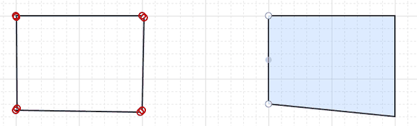
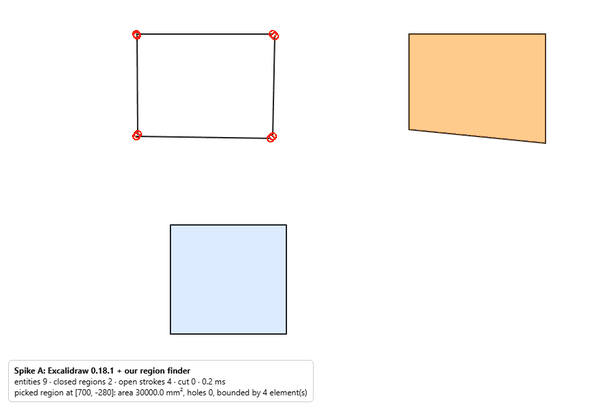
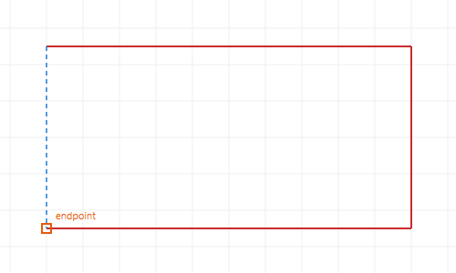
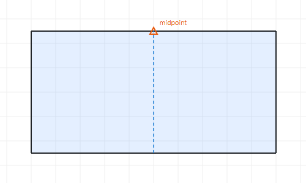
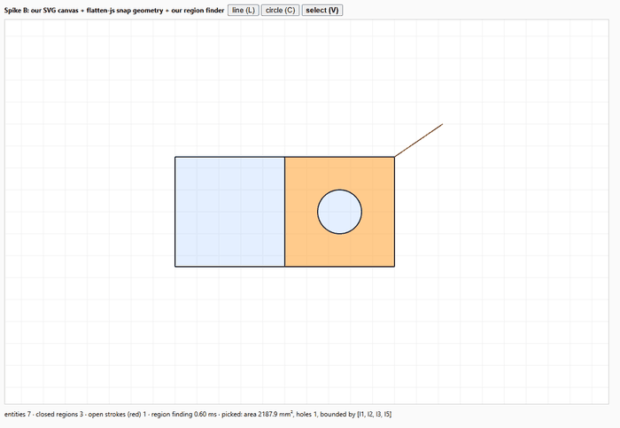
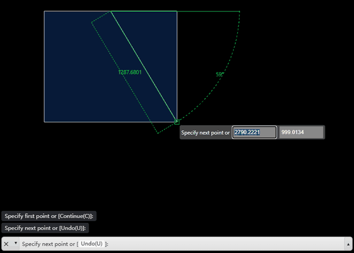

# Sketch tools survey: is there an off-the-shelf 2D sketcher for the Studio? (SK-6, 2026-10-17)

The answer to Zach's SK-6 question in `docs/feedback/2026-10-17-sketch-lines-regions.md`: "Is there a simple off the shelf sketching thing". It is research plus a throwaway spike. No Studio or core code changed.

| | |
|---|---|
| Written against | ArUco Studio `main` at `b0d33b5` |
| Requirements | SK-1..SK-6 (2026-10-17). MC-9 (file first) from `docs/feedback/2026-10-16-mini-cad-file-first.md`. `docs/design/M8_mini_cad_file_first.md` §3, "the library question". `docs/ARCHITECTURE.md` §2 (the stdlib core) |
| Live data | GitHub, the npm registry and downloads API, PyPI and pypistats, read on 2026-10-17. LICENSE files read directly for tldraw, JSketcher and CADmium |
| Spike | `C:\Users\BAM\Documents\aruco-studio-wt\sketch-spike\`: outside this repo, not committed anywhere, served on 127.0.0.1:5397 (stopped). The packages are pinned in section 4 |

## 0. The answer

**Nothing off the shelf is good enough to adopt as the Studio's sketch canvas. Recommended: keep our SVG canvas, add a small snapping module on flatten-js (MIT) geometry, and put region finding in the stdlib Python core.** We checked about 40 projects. No embeddable, permissively licensed component gives lines + arcs + endpoint snapping + click-to-pick regions out of the box.
- The closest is **@mlightcad/cad-simple-viewer** (MIT). It is a real AutoCAD-like web editor; its endpoint osnap closed our box exactly in the spike. But it is a whole CAD runtime (3.9 MB of JS, its own three.js scene pinned to three 0.172, its own database and undo), its region picking is a HATCH command rather than a selection, and it has one maintainer and is 14 months old.
- **Excalidraw** (MIT) was disproved in the spike: line ends do not snap to other lines, and it has no arcs.
- **tldraw** has the best API, but it is not open source: production needs a licence key, and the free hobby tier requires a watermark.
- The whole CAD apps are either copyleft (Chili3D, AGPL), source-available (JSketcher requires copyright assignment of every change; CADmium is Elastic-2.0 and archived) or tied to a paid cloud engine (Zoo).

So the best mix is ours, with libraries where they pay:
- **The canvas:** our SVG canvas (`Canvas2D.tsx` already does pan, zoom, select, drag, marquee, handles and tags).
- **Snapping:** a small pure snapping module on **flatten-js** (MIT) geometry. In the spike it took 24 lines for endpoint, midpoint, centre, quadrant, intersection, nearest, axis and grid, and it closed shapes bit-exact.
- **Region finding:** a stdlib half-edge face finder in **the core** (`plan/arrange.py`, about 300 lines in the spike). It is the single truth. **shapely** (and JSTS) agree with it on every fixture, so shapely is used only as a test oracle.
- **No constraint solver in v1.** **planegcs** (LGPL-2.1 wasm) comes later, or **ezpz** (MIT) if LGPL is unwelcome.

The file gains `curves` (line, arc, circle, polyline, point) and a `region` shape picked by a seed point. Every existing shape stays exactly as it is.

## 1. The bar

| Must | Why | What it rules out |
|---|---|---|
| The file is the model (MC-9) | an AI types curves into the scene file; the Studio views and edits that text | tools whose own document model would be the truth (whiteboards, CAD apps with a database) unless the sync is cheap |
| The core finds regions with no browser (MC-9, SK-3) | `python -m aruco_studio check` and the compile must see the same regions the Studio shows | browser-only region finding |
| Stdlib core (ARCHITECTURE §2) | `core/` and `plan/` must run inside Fusion's Python | numpy or GEOS in `plan/` |
| Licence | the Studio may be given away on a public site | GPL, AGPL and source-available tools in the bundle |
| One canvas for curves + tags + labels + face nets | the 2D view is "what prints" (M8 §1.4) | a second canvas we would overlay and sync |
| The 0.05 mm chord and the versioned rules | every loop the plan sees is stroked at `CHORD_MM` | another tessellation reaching the plan |

## 2. Comparison

Health is as of 2026-10-17: stars, the last release, and weekly downloads where useful. "Regions" means closed faces with holes found from strokes.

### 2.1 Interactive sketchers and whole apps (groups a, e)

| Option | Licence | Health | Draws | Snaps | Constraints | Regions | Fits React 19 + our JSON | Effort | Verdict |
|---|---|---|---|---|---|---|---|---|---|
| **Our SVG canvas + flatten-js + core regions** | ours + MIT | flatten-js 654★, 1.6.14 (2026-08), 78k/wk | lines, arcs, circles, polylines (to build) | all we write; spike: endpoint, mid, centre, quadrant, intersection, nearest, H/V, grid | later (planegcs / ezpz) | core (spike: matches shapely) | native: edits the file as today | 10-11 d | **recommended** |
| @mlightcad/cad-simple-viewer | MIT | 1,169★, 1.7.6 (2026-10-16), 82 releases since 2025-08, 1 main maintainer, 18.7k/wk | line, pline, arc, circle, ellipse, rect, polygon, spline, hatch, dims | endpoint, mid, centre, quadrant, intersection, perpendicular, tangent, nearest; ortho, polar; **no grid** | none | HATCH pick-points only (a command) | framework-free (ran in a React 19 page); AcDb database to sync with the file; peer `three ^0.172` | 6-10 d + sync | runner-up |
| Excalidraw | MIT | 134k★; stable 0.18.0 (2025-03), 0.18.1 (2026-04, a security fix); 783k/wk | line, arrow, rect, ellipse, diamond, freedraw; **no arcs** | bounding-box corners, centres, gaps, grid; **line ends never snap to lines** (spike) | none | none | `<Excalidraw>` with onChange / updateScene; px whiteboard model | 7-12 d fighting it | no |
| tldraw | **source-available**: production needs a licence key; the hobby tier means a watermark at tldraw's discretion | 51k★, 5.5.2 (2026-10-02) | line, arrow, geo shapes, draw; no arc tool | line handles snap to other shapes' points and outlines | none | none | excellent SDK, custom shapes | 6-10 d | licence blocks |
| JSketcher | MIT text **plus copyright assignment** of every change to Autodrop3d (verified) | 1,745★, pushed 2026-04 | lines, arcs, circles, ... | yes | own solver, ~17 kinds | `findClosedContours` (no holes) | React 16 app, not a package | n/a | licence trap; a reference only |
| Chili3D | **AGPL-3.0** | 4.9k★, active | lines, arcs, circles, polygons | object snaps, axis tracking | no | via OCCT | whole 3D app, no React | n/a | AGPL: the hosted Studio would become AGPL |
| CADmium | **Elastic-2.0** (verified) | **archived 2025-09** | | | | | | n/a | dead |
| Zoo Design Studio (modeling-app) | MIT app | 1.3k★, active | KCL sketches | yes | ezpz | yes | needs Zoo's **paid cloud geometry engine** and a login | n/a | no |
| CascadeStudio | MIT | 1.5k★ | code-CAD only | n/a | n/a | n/a | not interactive | n/a | no |
| JSXGraph | MIT or LGPL-3.0 (dual) | 1.5k★, 1.14.0 (2026-10-05), 54k/wk | points, segments, circles, arcs (as constructions) | snapToGrid, snapToPoints, attractors | dependencies, not a solver | no | mounts on a div; we write every tool | 6-10 d | no tools to save |
| OpenLayers / leaflet-geoman | BSD-2 / MIT | 12.6k★ / 2.4k★, active | linestring, polygon, circle; **no arcs** | vertex, edge, (intersection); geoman adds midpoints | no | no | map engines in a pixel CRS | 5-8 d | map-flavoured |
| Penpot / Graphite / SVG-Edit | MPL-2.0 / Apache-2.0 / MIT | 61k★ / 27.6k★ / 7.9k★ | vector paths, booleans | design-tool snaps | no | no | whole apps (iframe at best) | n/a | not CAD, not embeddable |
| dxf-viewer, three-dxf | MPL-2.0, MIT | viewers | none | none | none | none | display only | n/a | no |
| CADCraft (Rust + egui wasm) | Apache-2.0 (GitHub) | 5.5k★ but **created 2026-10-07**, v0.7.0 after a week, 707 open issues/PRs | AutoCAD-like set | full osnap set | yes | pick-point hatch with islands | an app, not a component | n/a | watch, too young |

### 2.2 Canvas libraries we would drive ourselves (group c)

| Library | Licence | Health | Gives | Snapping | Saves us |
|---|---|---|---|---|---|
| **flatten-js** | MIT | 1.6.14, 2026-08 | Segment / Arc / Circle with `intersect()` and `distanceTo()` (nearest point), PlanarSet for `search(box)` and `hit(point)`, polygons with booleans | no | the curve maths under snapping and hit tests, arcs exact: **used in spike B** |
| Konva + react-konva | MIT | 10.9.0 / 19.3.2 (2026-10-15), 3.0M/wk; react-konva 19.3 fits our React 19.3.1 | a canvas scene graph, drag, transformer, hit canvas | the docs' "snapping" demo is user code on bounding boxes | rendering only; our SVG already renders. The fallback if SVG ever gets slow |
| Paper.js | MIT | **stalled**: 0.12.18 (2024-07), no commits since | rich hitTest, intersections, booleans | no | arcs become Béziers (the centre and radius are lost) |
| Fabric.js | MIT | 7.4.0 (2026-05) | objects, controls | object guidelines in an extension | little: a scale/rotate object model |
| Two.js | MIT | 0.8.24 | a renderer | no | nothing |
| maker.js | Apache-2.0 | 0.19.2 (2026-01) | lines, arcs, circles first class; `findChains`, `combine` | no | chains, not faces (spike) |

### 2.3 Region finding from strokes (group d)

| Library | Licence | Side | Spike result (7 fixtures, section 4.1) | Notes |
|---|---|---|---|---|
| **our stdlib finder** (`regions_stdlib.py`) | ours | Python | **7 / 7** | ~300 lines; dangles, bridges, nesting, a 1e-6 mm tolerance |
| our JS port (`regions.js`) | ours | JS | **7 / 7**, the same faces as the Python | an optional display-side mirror |
| shapely 2.2 `polygonize_full` | BSD-3 | Python | 6 / 7 (the near miss needs `set_precision`) | numpy + GEOS: not stdlib; about 3x faster; **the test oracle** |
| JSTS 2.12.1 `Polygonizer` | EDL-1.0 or EPL-1.0 | JS | 6 / 7 (the near miss, as shapely) | the best off-the-shelf JS; last release 2024-11 |
| @turf/polygonize 7.4 | MIT | JS | 3 / 7 raw; 5 / 7 with our noding first | **never returns holes**, duplicates nested rings, no dangles out |
| maker.js `findChains` | Apache-2.0 | JS | 4 / 7: fails the T and X junctions; the plate only as nested chains | end-to-end chains nested by containment; a T or an X junction is not a face |
| planar-face-discovery | **CC-BY-4.0** | JS | not run | 2021, no negative coordinates, pre-noded input |
| Clipper2, Manifold CrossSection | BSL-1.0, Apache-2.0 | both | n/a | booleans of closed paths only, no polygonize |
| ezdxf 1.4 `edgeminer` | MIT | Python | n/a | joins endpoints only (no crossings), lists every simple loop (exponential), no nesting: not a face finder |

### 2.4 Constraint solvers (group b)

| Solver | Licence | State | For us |
|---|---|---|---|
| **@salusoft89/planegcs** (FreeCAD's GCS in wasm) | **LGPL-2.1** | 1.3.0 (2026-10-05), 107★, 11.7k/wk; one maintainer; used by GridSpace grid-apps | the pick when constraints come: about 90 constraint kinds, DOF, conflicting and redundant constraints, temporary drag constraints, 484 kB wasm, a JSON-by-id input like our file |
| PyPI `planegcs` (a different project, spookylukey) | LGPL-2.1 | 0.9.6 (2026-10-10), beta | **Python ≥ 3.12 only** (our core is 3.11), and not stdlib: no |
| SolveSpace (`slvs`) | **GPL-3.0** | mature C API | GPL would cover the bundle: no |
| ezpz (Zoo, Rust) | MIT | 53★, behind Zoo's 2026 sketch mode | 24 constraints; no npm package (we would write the wasm-bindgen wrapper): the MIT fallback |
| arael-sketch-solver, neoscad/sketch-solver | MIT (and Apache) | 12★ / 2 commits | too young; neoscad's bit-reproducible design is the one to re-check later |

## 3. The shortlist

### 1. Our SVG canvas + flatten-js + snapping + core regions (recommended)

| Pros | Cons |
|---|---|
| The file stays the model: the canvas writes JSON as it does today, with no second document to sync | We write and own the snapping and the tools (about 700-900 lines of TS). The "reasonable interactions" risk stays ours |
| One canvas for curves, tags, labels and face nets | No constraints until the solver milestone |
| Region truth is in the stdlib core: the same answer in Fusion, the CLI, the tests and the Studio | An arc tool needs designing (3-point plus Fusion's drag-from-endpoint tangent arc) |
| Permissive (MIT flatten-js) and small: the spike's page is 93 kB of JS plus 217 kB shared (React, the finder, flatten-js) | |
| Fits React 19, zustand, the kit and the light theme as they are | |
| Every piece is a pure function: snap, tools and arrange are unit-testable. The spike's one snapping bug would have been one failing test | |
| Spike B: a closing click about 6 px off snapped bit-exact; midpoint, axis and grid snaps; 3 regions + 1 open stroke live; pick with a hole; 0.6 ms per region pass | |

### 2. @mlightcad/cad-simple-viewer (MIT): the runner-up

| Pros | Cons |
|---|---|
| The real AutoCAD feel today: LINE / ARC / CIRCLE / PLINE / RECT / POLYGON, 8 osnap kinds, ortho, polar, dynamic input (typed coordinates, live length and angle), grips, undo, touch | A whole CAD runtime: 3.96 MB of JS (1.0 MB gzip), its own three.js scene and a second WebGL context beside our 3D view |
| Its entities map 1:1 onto our curves (AcDbLine / AcDbArc / AcDbCircle) | Peer `three ^0.172` against our 0.186.1: it ran only through an npm `overrides` entry, an unsupported combination |
| Framework-free: it ran inside a React 19 page | Fetches its template and fonts from cdn.jsdelivr.net unless we self-host them (`baseUrl`) |
| Spike C: four LINE commands, each started 3-4 px off, met with gaps of exactly 0; our finder found the region and our overlay picked it | One main maintainer, 14 months old, 82 releases: a fast-moving API |
| | AutoCAD command-line UX and a dark look, against MC-10's compact modern kit |
| | No grid snap; coordinates are raw floats (`1465.2102237964398`), so we would round on every write |
| | Its database and undo stack against our file and text history: a two-way sync |
| | Tags, labels and face nets would be an overlay kept in step with its view |
| | Region selection is still ours (its HATCH pick-points is a command, not a selection) |

### 3. Excalidraw (MIT)

| Pros | Cons |
|---|---|
| MIT, 134k★, a polished whiteboard with undo and touch | **Disproved in the spike: line ends do not snap to other lines.** Object snapping skips the line and arrow tools, and its snap targets are bounding-box corners and centres. A hand-drawn box stayed open by 2.2-4.2 px |
| A React component with `onChange`, `updateScene` and `onPointerDown` | Grid mode closes a box only by rounding both ends to the 20 px grid, which skews it |
| Spike A: the region overlay and the pick worked | No arcs. Lines draw as rounded splines unless forced sharp |
| | Closed polylines (`polygon`) are only on unreleased master; stable releases are rare |
| | 1.43 MB initial JS plus about 6.5 MB of lazy chunks and fonts |
| | A px whiteboard model (roughness, bound text) to map both ways |

tldraw would beat all three on API quality if the licence were acceptable. Its line handles do snap to other shapes' vertices. But it needs a licence key in production, and the free hobby tier carries a watermark at tldraw's discretion.

## 4. The spike

Three pages and two finder implementations, with pinned packages:
- react 19.3.1, @excalidraw/excalidraw 0.18.1, @mlightcad/cad-simple-viewer 1.7.6, @flatten-js/core 1.6.14, @turf/polygonize 7.4.0, makerjs 0.19.2, jsts 2.12.1, vite 8.3.4, playwright 1.64.1 (the installed Chrome, headless).
- shapely 2.2.0 (GEOS 3.14.1) and pillow in a spike venv.

The drivers click with deliberate 2-6 px jitter, so a snap has to do the work.

### 4.1 Regions, core side: our stdlib finder against shapely, JSTS, turf and maker.js

Fixtures are JSON curve lists, as a scene file would hold them (`fixtures/sketches.json`).

| Case | Expected | ours (Python) | ours (JS) | shapely | JSTS | turf | maker.js |
|---|---|---|---|---|---|---|---|
| square + a tail | 1 face, the tail open | ok | ok | ok | ok | ok | ok |
| two rooms (T junctions) | 2 faces | ok | ok | ok | ok | 1 face raw; ok pre-noded | 1 chain (the outline) |
| crossing rectangles (X) | 3 faces | ok | ok | ok | ok | 2 raw; ok pre-noded | 2 chains |
| plate + circular hole + island in it | 3 faces, two with a hole | ok | ok | ok | ok | 5 polygons, no holes, duplicates | 3 nested chains |
| slot of 2 lines + 2 arcs | 1 face | ok | ok | ok | ok | ok | ok |
| near miss: one gap 4e-7 mm, one 0.5 mm | 1 face, 4 open | ok | ok | 0 faces (ok with `set_precision(1e-6)`) | 0 faces | 0 faces | 1 closed + 1 open chain |
| bridge between two boxes | 2 faces, 1 cut | ok | ok | ok | ok | ok | 2 chains |

| Timing | ours (Python) | shapely | ours (JS, node) |
|---|---|---|---|
| plate + hole + island, one call | 0.85 ms | 0.21 ms | 0.37 ms |
| stress: 21 + 21 crossing lines + 30 circles = 72 curves, 872 segments, **594 faces** | 44-50 ms | 15 ms | 29-31 ms |

- JS and Python gave the same faces on every case and on the stress test.
- Their coordinates were bit-identical except 2 points that differed by 1.8e-15 mm: `Math.cos` and the C library's `cos` differ by an ULP. So the two sides can agree to a tolerance, never by bits. That is one reason the file must never store derived loops (section 5.2).
- A click picks a face: the smallest face whose outer loop holds the point and none of whose holes do. On the plate it picked the plate with its hole, the ring around the island, and the island, by point.

### 4.2 The three canvases

| | A: Excalidraw 0.18.1 | B: our SVG + flatten-js | C: mlightcad 1.7.6 |
|---|---|---|---|
| **Lines snap end to end** | **No.** Four lines started 3-4 px off stayed open by 4.24, 4.24, 3.61 and 2.24 px. Grid mode closed them by rounding (gaps 0), but skewed the box. A polyline clicked back onto its own start closed exactly | **Yes, bit-exact.** The closing click about 6 px off landed on `[-60, -25]` exactly; H/V inference squared the box; a midpoint snap placed a wall | **Yes, exactly.** Endpoint osnap: all four gaps 0.0 |
| **Regions found live** | yes, from its `onChange` elements (0.2-0.3 ms) | yes: 3 regions (2500, 2188 with a hole, 312 mm²) and the tail flagged red (0.6 ms) | yes, from its database events |
| **Click picks a region** | yes, through `onPointerDown` (scene coordinates) | yes; hover highlights first | yes, through our overlay (`screenToWorld`) |
| Page JS | 1.43 MB initial (+ about 6.5 MB lazy) | 93 kB + 217 kB shared | 3.96 MB |
| Other | lines are rounded splines unless forced `sharp`; some nested radix packages declare React ≤ 18 peers | my first snapper read flatten-js's shortest segment backwards (it runs from the shape to the point), so every click became an unsnapped "nearest". One unit test would catch it | needs three 0.172 (0.186.1 worked through an override); fetches from cdn.jsdelivr.net; floats like `1465.2102237964398` |



*A. Left: four lines drawn with object snapping on. The ends do not meet (red rings = open ends). Right: the same in grid mode. It is closed and found as a region, but the ends were rounded to the grid.*



*A. A polyline closed on its own start becomes a region; clicking inside the grid square picks it (orange).*

 

*B. The endpoint glyph as the chain closes (the open chain is red until it closes); the midpoint glyph as a wall splits the box.*



*B. Live regions: the left room, the right room with its hole (picked, orange), the disc. The tail is open (red).*



*C. mlightcad's LINE command: the endpoint osnap marker, typed coordinates, live length and angle. Our overlay fills the found region.*

### 4.3 What the spike proved and disproved

| Claim | Result |
|---|---|
| An off-the-shelf whiteboard gives CAD endpoint snapping | **disproved** for Excalidraw (measured, and read in its source: `isActiveToolNonLinearSnappable` excludes line and arrow) |
| An off-the-shelf permissive CAD editor exists | **proved** for mlightcad: osnap works. Integrating it costs a runtime, a sync and a three.js pin |
| Snapping is small when the geometry comes from a library | **proved**: 24 lines with flatten-js, exact coincidence by copying the snapped numbers |
| Region finding fits the stdlib core | **proved**: about 300 lines, the same faces as shapely and JSTS on every fixture, 1-50 ms |
| The off-the-shelf JS region finders are enough | **disproved** for turf (no holes) and maker.js (chains, not faces). JSTS is right but brings a JTS port and still needs our tolerance |
| Both sides can agree | **proved** to 1.8e-15 mm, not bit for bit: the file must store curves and seeds, never loops |

## 5. Migration sketch (the recommended option)

### 5.1 The file: curves and regions

A sketch gains `curves`. A curve is drawn geometry, in the sketch's frame (mm, CCW). A new shape kind, `region`, picks one closed face of the curves.

| Curve | Written as | Notes |
|---|---|---|
| line | `{"id", "line": [[x0, y0], [x1, y1]]}` | |
| arc | `{"id", "arc": {"at": [cx, cy], "from": [x0, y0], "to": [x1, y1]}}` | counter-clockwise from `from` to `to`. The ends are exactly the typed points, so they meet lines exactly. The radius is \|from − at\|; `to` must be within 0.001 mm of that circle, else an `error` |
| circle | `{"id", "circle": d, "at": [x, y]}` | the shape vocabulary's circle, as a curve |
| polyline | `{"id", "polyline": [[x, y], ...], "closed": true}` | sugar for lines; segment `i` is `<id>.<i>` |
| point | `{"id", "point": [x, y]}` | a reference point: it snaps, it bounds nothing |
| any curve | `"construction": true` | drawn dashed, ignored by regions (centre lines, guides) |

A shape `{"id", "region": [x, y]}` is the smallest closed face of its sketch's curves that holds the seed point `[x, y]`. This is AutoCAD HATCH's "pick internal point". `extrude` and `aruco` name it like any shape.

Coincidence is equality: two ends meet when their numbers are equal, to within `TOL = 1e-6` mm. The snapper writes the other end's exact numbers (spike B: bit-exact). An AI typing a file types the same number twice.

```json
{
  "schema": "arucostudio.scene/3",
  "name": "plate drawn as curves",
  "preset": "0.32mm SPEED @MK4IS 0.6 - Aruco",
  "sketches": [
    {"id": "sk",
     "curves": [
       {"id": "l1", "line": [[-40, -25], [40, -25]]},
       {"id": "l2", "line": [[40, -25], [40, 25]]},
       {"id": "l3", "line": [[40, 25], [-40, 25]]},
       {"id": "l4", "line": [[-40, 25], [-40, -25]]},
       {"id": "h1", "circle": 18, "at": [20, 0]},
       {"id": "d1", "arc": {"at": [-20, 0], "from": [-20, -8], "to": [-20, 8]}},
       {"id": "d2", "line": [[-20, 8], [-20, -8]]},
       {"id": "cl", "line": [[0, -30], [0, 30]], "construction": true}
     ],
     "shapes": [{"id": "plate", "region": [0, 15]}]}
  ],
  "features": [
    {"id": "body", "extrude": "plate", "height": 5},
    {"id": "tag", "aruco": "body.top", "layout": "charuco", "cols": 5, "rows": 3},
    {"id": "edge", "aruco": "body.l1", "layout": "single"}
  ]
}
```

- The circle `h1` and the D (`d1` + `d2`) lie inside the plate, so they are its holes with nothing written. Clicking inside the D would pick the D itself (an island region).
- The side face on a line curve is named by the curve's id (`body.l1`). An arc's side is curved and has no face. `side<i>` stays as today for every shape.

**Constraints (later, a pure addition):**
- `"constraints": [{"id": "k1", "horizontal": "l1"}, {"coincident": ["l1.1", "l2.0"]}, {"distance": "l1", "value": 80}]`.
- `l1.0` / `l1.1` are a line's ends and `d1.at` an arc's centre.
- The solved coordinates stay in the curves (the file stays the truth). Only the Studio solves, on an edit. The core never solves; it can check residuals and warn when a constraint no longer holds.

### 5.2 Where regions are found, and how both sides agree

| | |
|---|---|
| The truth | `plan/arrange.py` (new, stdlib): curves → stroke at `CHORD_MM` (ends exact) → node (split at crossings and T junctions) → merge points within `TOL` → drop dangles and bridges (reported as `open` / `cut` curve ids) → a half-edge face walk → hang each component's outside in the smallest face around it (a hole). The spike's `regions_stdlib.py`, hardened |
| The compile | `scene/design.py` resolves a `region` shape to a `loops` shape in memory: `{"loops": [outer, *holes], "at": the outer loop's box centre (rounded to 1e-6)}`, loops relative to `at`. From there the existing path runs (`plan/shapes.extruded_top` → `from_loops(centre=False)`), so **a region plans exactly as the equivalent typed `loops` shape**. That is a test: same `record_digest` |
| Errors | `sketches[0].shapes[0].region`: "no closed region at [0, 15]: the curves around it are open at l3 (ends [40, 25])". `check` prints every sketch's regions and open curves, so an AI loop can fix a gap without a browser |
| The server | `GET /api/design` and `POST /api/design/preview` gain `regions: [{sketch, faces: [{outer, holes, area, by: [curve ids]}], open, cut}]` in canvas mm, like `shapes_2d`. The 15 Hz drag preview already exists |
| The browser | draws the server's faces and does point-in-polygon on them for hover and pick. **It never computes a loop** (M8 §3 rule kept). One round trip after each committed stroke is "live" (the finder takes 1-50 ms) |
| If latency ever bites | the spike's `regions.js` port can run in the browser for display only. It must pass the same golden corpus as the Python (`goldens/sketch_regions.json`: the spike's 7 cases + Fusion-like faces, areas, hole counts, `by` ids, coordinates to 1e-9). The file stores curves and a seed, never loops, so a mirror's ULP can never reach a plan |
| shapely | a **test oracle only**, in `tests/` (numpy is already in `requirements.txt` for `verify/`). A property test draws random curve sets and compares faces. Not in `plan/`: it would break the stdlib rule and Fusion |
| Seeds under edits | while the Studio drags a curve, it follows the picked region by its `by` ids and rewrites the seed when the old one would fall outside (a point inside the same face). A hand or AI edit that moves the seed out is an `error` on the region, never a silent re-pick |

### 5.3 What changes in the Studio

| Today | After |
|---|---|
| `Canvas2D.tsx`'s `draw` drag (rect / circle / slot by drag) | a tool state machine in `sketch/tools.ts`: line chain (click, click; Enter or Esc ends; landing on an end closes), polyline, circle (centre, radius), arc (3-point; and in the line tool, a drag from the last end gives a tangent arc, Fusion's gesture), typed lengths (L, then `40` Enter: 40 mm along the cursor) |
| `model/design.ts` `snap()` (the 0.5 mm grid) | `sketch/snap.ts` (pure, on flatten-js): endpoint > centre > intersection > midpoint > quadrant > nearest > H/V inference > the 0.5 mm grid; a glyph and a word at the cursor; Alt turns it off. The same snapper for moves and handles |
| shapes drawn as outlines | a curves layer (open ends ringed red, construction dashed) and a regions layer (the server's faces: a light fill, hover darker, picked orange) under the tags |
| `sketch/handles.ts` | kept for the five old shape kinds. New vertex handles on curves move every end at the same coordinates (coincidence by equality) |
| R / C / O / P tools write `rect` / `circle` / `slot` / `polygon` shapes | they write curves + a `region` (a rectangle = 4 lines, a slot = 2 lines + 2 arcs, a polygon = a closed polyline). `shapeFromDrag` retires. **Convert to curves** turns an old shape into curves + a region (explicit, since a `rect` plans as a box) |
| H cuts a round hole in a shape | for curves, a circle inside a region is already a hole; H stays for old shapes |
| E / A take a shape or a face | they also take a picked region. If no `region` shape holds that face yet, they write one with the click as its seed |
| `store.ts` `ToolId` | gains `line`, `polyline`, `arc`; `polygon` becomes `polyline`. Keys: L line, P polyline, C circle, R rectangle, O slot, arc in the palette (S) |

### 5.4 Old files keep loading, bit for bit

| Rule | |
|---|---|
| Shapes | the five kinds and their code paths are untouched (`plan/shapes.py`). A `/2` file compiles to the same Scene, Targets and plans |
| The schema | `arucostudio.scene/3` = `/2` + `curves` + `region`. `MIGRATIONS["arucostudio.scene/2"]` is the identity. A `/2` reader refuses a `/3` file with today's "saved by a newer ArUco Studio?" message |
| The writer | keeps the file's schema string until the file first holds a curve or a region, so a `/2` file the new Studio only opens (or edits with the old tools) stays a `/2` file, byte for byte |
| Tests | every example and e2e saved scene replans with the same `record_digest`; the 824 goldens unchanged; `/1` → `/2` → `/3` chains |
| Versioned rules | `SPEC_VERSION`, `CELL_RULE`, the label, origin, trim and make rules: untouched. A region is one more way to reach `Target.loops_mm` |

### 5.5 SK-1 .. SK-5

| | How |
|---|---|
| SK-1 lines | the `line` curve and the L tool (chains), plus polylines |
| SK-2 one CAD sketch | a sketch's `curves` are the sketch: lines, arcs, circles, points. The 2D view draws all of them; the R / C / O / P tools write curves; old shapes stay as legacy |
| SK-3 live closed regions | `plan/arrange.py` finds the faces and the open and cut curves on every compile and preview; the canvas fills the regions and rings open ends red (spike B) |
| SK-4 select a region = the profile | click a filled region: it is picked; E or A use it (a `region` shape with the click as its seed) |
| SK-5 snapping | `sketch/snap.ts`: endpoint, midpoint, centre, quadrant, intersection, nearest, H/V, grid, with glyphs. The snapped numbers are copied, so the ends meet exactly (spike B) |
| SK-6 off the shelf | the libraries carry the hard parts: flatten-js (curve maths), shapely and JSTS (oracles), planegcs (constraints, later). The interaction code we own is small, pure and tested |

### 5.6 Milestones

| Milestone | Gives | Days |
|---|---|---|
| SK-a core | `plan/arrange.py` (stdlib); `curves` and `region` in `scene/design.py`; side faces by curve id; schema `/3` with the identity migration; FILE_FORMAT §3; `goldens/sketch_regions.json`; the shapely oracle test; `check` prints regions and open curves | 3 |
| SK-b server | `regions` in `/api/design` and the preview; OpenAPI types regenerated | 0.5 |
| SK-c drawing | the curves layer; `sketch/snap.ts` with flatten-js; line, polyline, circle and arc tools; typed lengths; vertex handles; open-end rings; unit tests for every snap kind | 4-5 |
| SK-d regions in the Studio | fill, hover, pick; E and A on regions; R / C / O / P write curves; Convert to curves | 1.5 |
| SK-e verify | e2e: draw a box by snapping with jittered clicks, pick, ArUco Extrude; its plan equals the typed file's; the `/2` replay test | 1 |
| Later | constraints and dimensions (planegcs; the LGPL page and source link); several regions as one profile (a union through `plan/region.py`); trim and extend | 4-6 |

v1 (SK-a..e) is about 10-11 days. It does not touch M8's other milestones.

## 6. What each licence family would oblige (a free hosted Studio; not legal advice)

| Family | Examples here | Obliges |
|---|---|---|
| MIT, BSD, Apache-2.0, BSL-1.0, EDL | flatten-js, Konva, Excalidraw, mlightcad, shapely, JSTS (EDL), Clipper2 | keep the notices (a third-party licences page) |
| MPL-2.0 | Penpot, dxf-viewer | publish our changes to MPL files; the rest unaffected |
| LGPL-2.1 / 3.0 | planegcs, JSXGraph (if LGPL is chosen) | the notice and the library's exact source (or an offer); keep it replaceable (an unmodified separate `.wasm`); terms that allow reverse engineering |
| GPL-3.0 | SolveSpace, three.cad | the bundle that links it is GPL; source to every visitor |
| AGPL-3.0 | Chili3D | GPL, plus source to every network user: the hosted Studio would be AGPL |
| Source-available | tldraw (licence key; hobby = watermark), CADmium (Elastic-2.0: no hosted service), JSketcher (every modification assigned to Autodrop3d) | not open source: avoid |
| CC-BY-4.0 | planar-face-discovery | attribution; not a software licence, no patent grant |

## 7. Open questions for Zach

| # | Question | Recommended default |
|---|---|---|
| 1 | Our canvas with our snapping (section 3, option 1), or try mlightcad's AutoCAD-style editor (command line, dark, 4 MB) behind a flag first? | **Our canvas.** mlightcad is the one to revisit if the AutoCAD feel matters more than one canvas and file-first |
| 2 | A region is picked by a seed point (AutoCAD HATCH's "pick internal point"), and the Studio re-seeds it during edits. OK? | **Yes.** An AI can type it; it survives edits that keep the face |
| 3 | The R / C / O / P tools draw curves (one CAD sketch), and old shapes stay as legacy until "Convert to curves". OK? | **Yes**: SK-2 |
| 4 | Constraints: when, and is LGPL planegcs (a separate wasm, a licence page) fine, or MIT ezpz with our own wrapper? | **Later; planegcs** |
| 5 | "I like with the arrows how I can draw it and then they snap": which app? If it is Excalidraw (Obsidian's plugin), its arrows bind to shapes, but its lines do not snap to lines (spike A) | the snapper in 5.3 gives line-to-line snapping |

## Sources

- Live metadata, 2026-10-17: api.github.com repos (stars, `pushed_at`, licence, open issues), registry.npmjs.org and api.npmjs.org/downloads, pypi.org JSON, pypistats.org.
- Licences: https://raw.githubusercontent.com/tldraw/tldraw/main/LICENSE.md, https://tldraw.dev/community/license, https://raw.githubusercontent.com/xibyte/jsketcher/master/LICENSE, https://github.com/CADmium-Co/CADmium (LICENSE.md: Elastic License 2.0), https://github.com/xiangechen/chili3d.
- Excalidraw snapping: `@excalidraw/excalidraw@0.18.1` dist (`getElementsCorners`, `getSnapLinesAtPointer`, `isActiveToolNonLinearSnappable`, `isPathALoop`); https://docs.excalidraw.com/docs/@excalidraw/excalidraw/api/props/.
- tldraw: https://tldraw.dev/sdk-features/snapping, https://tldraw.dev/pricing.
- mlightcad: https://github.com/mlightcad/cad-viewer (README, `AcApHatchCmd.ts`), the `@mlightcad/cad-simple-viewer@1.7.6` and `@mlightcad/data-model@1.15.11` packages (`AcDbOsnapMode`, `AcApDocManager`).
- Zoo: https://github.com/KittyCAD/modeling-app, https://zoo.dev/blog/announcing-solver, https://github.com/KittyCAD/ezpz.
- Solvers: https://github.com/Salusoft89/planegcs, https://pypi.org/project/planegcs/, https://github.com/solvespace/solvespace, https://github.com/harakas/arael, https://github.com/neoscad/sketch-solver.
- Region finding: https://shapely.readthedocs.io/en/stable/reference/shapely.polygonize_full.html, https://shapely.readthedocs.io/en/stable/reference/shapely.node.html, https://github.com/bjornharrtell/jsts, https://github.com/Turfjs/turf/tree/master/packages/turf-polygonize, https://maker.js.org/docs/working-with-chains/, https://ezdxf.readthedocs.io/en/stable/edgeminer.html, https://github.com/ammanvedi/planar-face-discovery, https://www.angusj.com/clipper2/Docs/Overview.htm, https://manifoldcad.org/jsdocs/classes/manifold_encapsulated_types.CrossSection.html, https://cp-algorithms.com/geometry/planar.html, https://www.geometrictools.com/Documentation/MinimalCycleBasis.pdf.
- Canvas libraries: https://github.com/alexbol99/flatten-js, https://konvajs.org/docs/sandbox/Objects_Snapping.html, https://github.com/paperjs/paper.js, https://github.com/fabricjs/fabric.js, https://two.js.org/docs/path/.
- Others: https://github.com/jsxgraph/jsxgraph, https://openlayers.org/en/latest/apidoc/module-ol_interaction_Snap-Snap.html, https://geoman.io/docs/leaflet/modes/draw-mode, https://github.com/storytold/cadcraft, https://github.com/GraphiteEditor/Graphite, https://github.com/penpot/penpot, https://github.com/SVG-Edit/svgedit, https://github.com/vagran/dxf-viewer, https://github.com/zalo/CascadeStudio.
